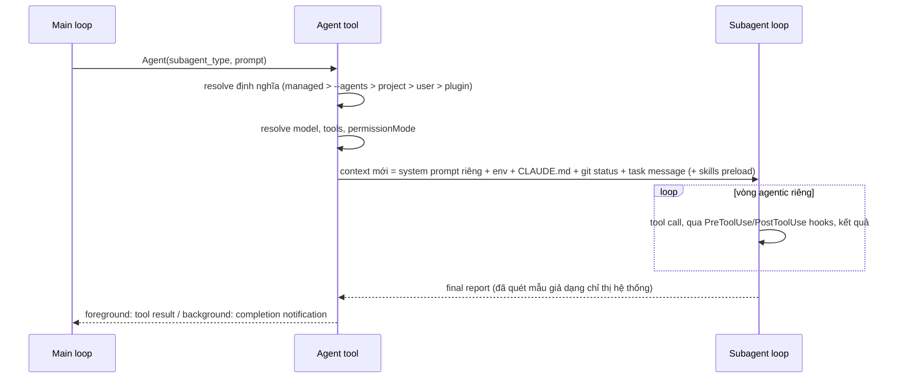
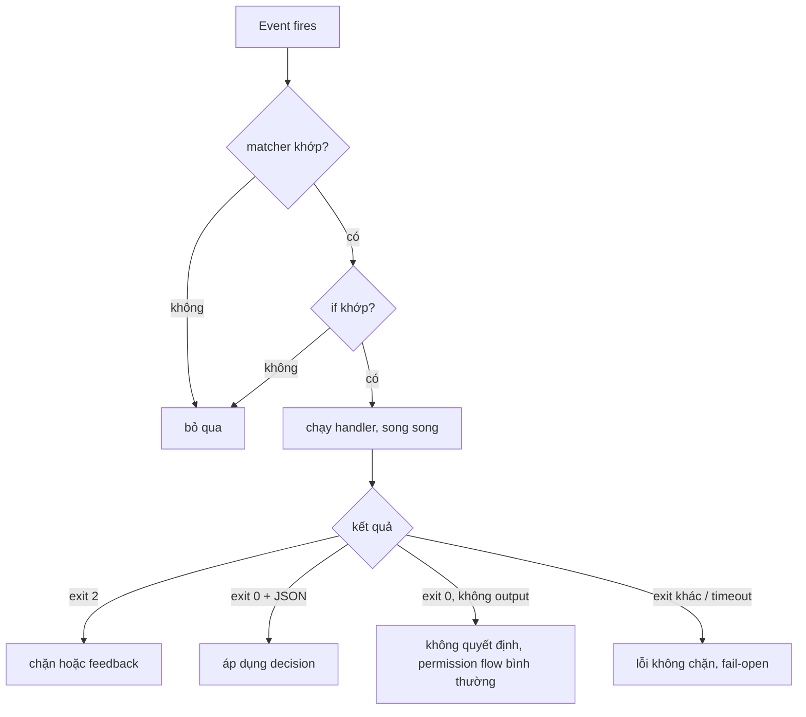

# Claude Code: cơ chế hoạt động bên trong và đặc tả để port sang mọi agent

> Cập nhật 05/11/2026. Phần Claude Code đối chiếu với docs chính thức tại `code.claude.com` (các trang permissions, permission-modes, memory, mcp, hooks, skills, sub-agents, worktrees, context-window, checkpointing, prompt-caching, settings, tools-reference, how-claude-code-works). Phần Codex, Cursor, Antigravity đối chiếu với docs chính thức của từng công cụ (liệt kê ở mục 22); chỗ nào chưa đọc được docs thì ghi **chưa xác minh**.
> Số version (v2.1.x), tên field và số lượng hook event đổi theo bản phát hành. Kiểm tra bằng `claude --version` và docs hiện hành trước khi áp dụng.

## Mục lục

1. [Mục tiêu và cách đọc](#1-mục-tiêu-và-cách-đọc)
2. [Claude Code khác gì Codex](#2-claude-code-khác-gì-codex)
3. [Harness và agentic loop](#3-harness-và-agentic-loop)
4. [Tools](#4-tools)
5. [Permission system](#5-permission-system)
6. [Plan mode](#6-plan-mode)
7. [Memory: CLAUDE.md, rules, AGENTS.md, auto memory](#7-memory-claudemd-rules-agentsmd-auto-memory)
8. [Context window, compaction, prompt cache](#8-context-window-compaction-prompt-cache)
9. [Settings](#9-settings)
10. [Subagent](#10-subagent)
11. [Skills](#11-skills)
12. [Hooks](#12-hooks)
13. [MCP](#13-mcp)
14. [Worktrees](#14-worktrees)
15. [Sessions và checkpoints](#15-sessions-và-checkpoints)
16. [Plugins](#16-plugins)
17. [Godkit đang dùng các cơ chế này thế nào](#17-godkit-đang-dùng-các-cơ-chế-này-thế-nào)
18. [Bản đồ tổng hợp và cách chọn](#18-bản-đồ-tổng-hợp-và-cách-chọn)
19. [Tự kiểm chứng cơ chế](#19-tự-kiểm-chứng-cơ-chế)
20. [Mẫu cấu hình cho dự án Next.js / NestJS](#20-mẫu-cấu-hình-cho-dự-án-nextjs--nestjs)
21. [Ma trận tương đương và lộ trình cho godkit](#21-ma-trận-tương-đương-và-lộ-trình-cho-godkit)
22. [Giới hạn, nguồn, lịch sử sửa đổi](#22-giới-hạn-nguồn-lịch-sử-sửa-đổi)

---

## 1. Mục tiêu và cách đọc

Mục tiêu của dự án godkit: **mọi AI agent (Codex, Cursor, Antigravity, Gemini CLI...) làm được những gì Claude Code làm, với chất lượng tương đương**. Vì vậy tài liệu này vừa giải thích Claude Code, vừa là **đặc tả để port**.

Mỗi chương cơ chế (4 đến 16) có ba khối:

1. **Cơ chế trong Claude Code**: cách nó chạy, đã đối chiếu docs.
2. **Bất biến khi port**: những điều phải giữ nguyên thì agent khác mới đạt chất lượng tương đương. Mỗi bất biến phải kiểm được.
3. **Trên agent khác và godkit**: agent khác có gì, godkit đã phủ gì, còn thiếu gì, giả lập thế nào. Mã `P0` đến `P3` trỏ tới lộ trình ở mục 21.

Điều quan trọng nhất cần nhớ trước khi đọc tiếp: **chất lượng của Claude Code không nằm ở model mà ở harness** (mục 3). Port nghĩa là dựng lại các điểm ép luật của harness quanh một model khác, không phải viết lại model.

Quy ước độ tin cậy: câu không gắn nhãn là đã đối chiếu docs chính thức của chính công cụ đó. Nhãn **chưa xác minh** nghĩa là chưa đọc được docs hoặc docs không nói rõ.

---

## 2. Claude Code khác gì Codex

Cả hai đều là coding agent chạy ở terminal, IDE, desktop và web: đọc repo, sửa file, chạy lệnh. Khác biệt chính nằm ở triết lý:

- **Claude Code**: harness tuỳ biến sâu, làm việc tương tác trên máy local.
- **Codex**: sandbox-first, mạnh ở task chạy song song hoặc bất đồng bộ.

| | Claude Code | Codex |
|---|---|---|
| Surfaces | Terminal, VS Code, JetBrains, Desktop app, Web | CLI, Desktop app, IDE extension, cloud |
| File hướng dẫn repo | `CLAUDE.md` + auto memory. Đọc `AGENTS.md` **chỉ khi không có** `CLAUDE.md` trong thư mục làm việc hoặc thư mục cha (từ v2.1.277) | `AGENTS.md` theo cấp thư mục, file gần nhất được ưu tiên; global ở `~/.codex/` |
| Skills | Có (`SKILL.md`) | Có (`SKILL.md`) |
| Subagent | File markdown + frontmatter trong `.claude/agents/` | File TOML trong `.codex/agents/` (`name`, `description`, `developer_instructions` bắt buộc) |
| Hooks | 33 event, 5 loại handler | 14 event, file `hooks.json`; hook không do admin quản lý phải được duyệt qua `/hooks` (gắn với hash của hook) |
| MCP | Có | Có |
| An toàn | Permission rule + mode + hook + classifier (auto mode) | Sandbox mức kernel (Seatbelt, Landlock) và `approval_policy`; subagent kế thừa sandbox của cha |
| Mã nguồn | Closed-source | CLI viết chủ yếu bằng Rust, open-source |
| Đăng nhập | Claude subscription hoặc Anthropic Console; CLI/VS Code/JetBrains hỗ trợ third-party providers | ChatGPT account hoặc OpenAI API key |

Nhận định "Claude Code có những thứ mà bên khác không làm được" **không còn đúng**. Skills là chuẩn mở dùng ở nhiều công cụ; Codex, Cursor, Antigravity đều có hook. Điểm khác thật sự của Claude Code là **độ sâu và khả năng ghép các phần với nhau**: nhiều hook event, subagent có hook/MCP/memory/worktree riêng, subagent lồng nhau, fork dùng chung prompt cache, bảng quyền chi tiết. Đó chính là danh sách những thứ cần tái tạo ở agent khác.

---

## 3. Harness và agentic loop

### 3.1 Cơ chế trong Claude Code

- **Claude Code là harness, Claude là model bên trong.** Harness cung cấp tools, kiểm soát quyền, nạp memory, quản lý context và vòng lặp nối các hành động.
- **Agentic loop** có ba pha đan xen: thu thập context, hành động, kiểm chứng kết quả. Mỗi lần dùng tool trả thông tin ngược vào loop để quyết định bước tiếp theo. Loop thích nghi: một câu hỏi về code có thể chỉ cần pha đầu; sửa bug lặp cả ba pha nhiều lần.
- **Bạn là một phần của loop.** `Esc` dừng ngay: tool call đang chạy bị huỷ, tin nhắn đang xếp hàng được gửi tiếp. Gõ thêm rồi `Enter` khi Claude đang chạy: tin nhắn xếp hàng và được đọc ngay sau khi các tool call hiện tại xong, trong cùng lượt.
- **Claude Code tự chèn context** cạnh tin nhắn của bạn qua `<system-reminder>`: các file `CLAUDE.md`, hướng dẫn của output style, thông báo khi file đã đọc bị đổi trên đĩa, dòng attribution cho commit/PR. Nếu Claude làm theo một quy tắc bạn không viết (ví dụ thêm `Co-Authored-By`), nguồn thường là đây. Tắt bằng setting `attribution` hoặc `includeGitInstructions: false`.
- **Giao diện khác nhau, loop giống nhau**: terminal, VS Code, JetBrains, desktop, web, Remote Control, Slack, CI/CD dùng chung một loop.

### 3.2 Điểm ép luật của harness

Model chỉ sinh văn bản và yêu cầu gọi tool. Mọi thứ khác do harness quyết định:

| Việc | Ai quyết định |
|---|---|
| Tool nào tồn tại, tool nào chạy không cần hỏi | Harness (permission rule, mode) |
| Văn bản nào nằm trong context lúc bắt đầu và sau compaction | Harness (CLAUDE.md, memory, skills listing, hook) |
| Hành động có bị chặn trước khi xảy ra không | Harness (PreToolUse hook, permission) |
| Model có được dừng lượt không | Harness (Stop hook) |
| Model viết gì, chọn tool nào | Model |

Chỉ dẫn trong prompt hoặc `CLAUDE.md` chỉ định hình điều model *cố làm*; nó không đổi điều harness *cho phép*. Docs nói thẳng: permission rule do Claude Code ép, không phải model.

### 3.3 Bất biến khi port

- Có một **lớp ngoài model** chạy tại các điểm cố định của loop (trước/sau tool, khi mở phiên, khi dừng) và có quyền chặn, bơm context, ép tiếp tục.
- Quy tắc bắt buộc nằm ở lớp đó, không nằm trong prompt.
- Kết quả tool luôn quay lại loop (model thấy lỗi và tự sửa), không bị nuốt.
- Người dùng ngắt/điều hướng được giữa chừng mà không mất trạng thái.

### 3.4 Trên agent khác và godkit

| Host | Lớp ngoài model |
|---|---|
| Codex | Hooks (14 event) + sandbox/approval của chính Codex |
| Cursor | Hooks (21 event) |
| Antigravity | Hooks (6 event: `SessionStart`, `PreToolUse`, `PostToolUse`, `PreInvocation`, `PostInvocation`, `Stop`) |

Godkit đăng ký hook cho cả bốn host (cập nhật 05/11/2026): Claude Code và Codex đủ bộ qua `hooks/godkit-hooks.json`, Cursor và Antigravity một bộ con qua `hooks/adapt.js` (P0 ở mục 21, đã làm). Trước đó README và `docs/agent-portability.md` ghi hai host này "không có hook"; điều đó sai và đã được sửa.

---

## 4. Tools

### 4.1 Cơ chế trong Claude Code

Tools là thứ biến Claude từ "trả lời bằng chữ" thành agent. Tên tool là chuỗi chính xác dùng trong permission rule, danh sách tool của subagent và matcher của hook. Năm nhóm chính thức:

| Nhóm | Làm gì | Tool tiêu biểu |
|---|---|---|
| File operations | Đọc, sửa, tạo, đổi tên | `Read`, `Edit`, `Write`, `NotebookEdit` |
| Search | Tìm file theo mẫu, tìm nội dung bằng regex | `Glob`, `Grep` (mặc định không có trên macOS, Linux, WSL) |
| Execution | Chạy shell, server, test, git | `Bash`, `PowerShell`, `Monitor` |
| Web | Tìm web, đọc docs | `WebSearch`, `WebFetch` |
| Code intelligence | Lỗi kiểu, nhảy tới định nghĩa, tìm tham chiếu (cần plugin code intelligence) | `LSP` |

Ngoài ra có tool điều phối:

| Tool | Công dụng | Hỏi quyền? |
|---|---|---|
| `Agent` | Sinh subagent với context riêng (tên cũ `Task`, đổi ở v2.1.63) | xem docs |
| `SendMessage`, `ListAgents` | Nhắn/liệt kê agent: subagent, teammate, session khác | xem docs |
| `Skill` | Chạy skill trong hội thoại chính | Có |
| `AskUserQuestion` | Hỏi trắc nghiệm để làm rõ yêu cầu | xem docs |
| `EnterPlanMode`, `ExitPlanMode` | Vào plan mode / trình plan để duyệt | Không / Có |
| `EnterWorktree`, `ExitWorktree` | Vào/ra git worktree cô lập | xem docs |
| `TaskCreate/Get/List/Update`, `TaskStop` | Danh sách việc và dừng tác vụ nền | Không |
| `CronCreate/Delete/List`, `ScheduleWakeup` | Lên lịch trong phiên, nhịp cho `/loop` | xem docs |
| `ToolSearch` | Tìm và nạp tool bị hoãn | Không |
| `Workflow` | Chạy script điều phối nhiều subagent nền | Có |
| `Artifact`, `SendUserFile`, `PushNotification`... | Xuất kết quả ra ngoài terminal | xem docs |

Cột "Hỏi quyền?" ghi `Có` hoặc `Không` chỉ khi docs ghi rõ; còn lại là `xem docs` (bảng đầy đủ ở trang `tools-reference`).

Các điểm cơ chế đáng biết:

- **Tên canonical khác nhãn hiển thị.** Tool hiện là `Stop Task` trên giao diện có tên canonical `TaskStop`. Permission rule và hook matcher chỉ khớp tên canonical.
- **Tool bị hoãn nạp.** Với MCP, chỉ tên tool và instructions của server nằm trong context lúc đầu; định nghĩa đầy đủ được nạp khi Claude cần qua `ToolSearch` (mục 13).
- **Bash**: thư mục làm việc giữ lại giữa các lệnh nhưng biến môi trường thì không. Timeout mặc định 30 phút theo docs (giảm còn 10 phút trong `claude -p` với prompt dạng text), chỉnh bằng `BASH_DEFAULT_TIMEOUT_MS`. Lệnh chạy lâu chuyển được xuống nền; `Monitor` đẩy từng dòng output của tiến trình nền về cho Claude.
- **Deny rule dạng tên trần** (`Bash`) gỡ hẳn tool khỏi context; Claude không còn thấy nó.
- **Skill không thêm tool mới**: nó chạy qua tool `Skill`.

### 4.2 Bất biến khi port

- Agent có đủ năm nhóm năng lực: đọc/sửa file có kiểm soát, tìm kiếm, chạy lệnh, web, và (tuỳ chọn) code intelligence.
- Sửa file bằng **tool sửa có điểm neo** (thay đúng đoạn cũ bằng đoạn mới, báo lỗi nếu đoạn cũ không khớp hoặc không duy nhất), không ghi đè cả file. Đây là nguồn chất lượng lớn: sửa nhỏ, kiểm chứng được, ít phá file.
- Mỗi tool call trả kết quả hoặc lỗi *có cấu trúc* cho model; lỗi không bị nuốt.
- Tên tool ổn định để rule/hook khớp được.
- Tool phụ thuộc môi trường (shell) khai báo rõ hành vi cwd và timeout.

### 4.3 Trên agent khác và godkit

Tên tool khác nhau theo host, và đây là phần adapter hook (P0) phải dịch:

| Khái niệm | Claude Code | Cursor (matcher của `preToolUse`) | Codex / Antigravity |
|---|---|---|---|
| Chạy shell | `Bash` | `Shell` | Hook `PreToolUse` có matcher theo tên tool; tên chính xác **chưa xác minh** |
| Đọc file | `Read` | `Read` | chưa xác minh |
| Sửa/tạo file | `Edit`, `Write`, `NotebookEdit` | `Write` | chưa xác minh |
| Tìm | `Grep`, `Glob` | `Grep` | chưa xác minh |
| Xoá | (qua Bash) | `Delete` | chưa xác minh |
| Giao việc cho subagent | `Agent` | `Task` | chưa xác minh |
| Tool MCP | `mcp__server__tool` | `MCP:<tool_name>` | chưa xác minh |

Godkit hiện đặt matcher `Bash` và `Edit|Write|MultiEdit|NotebookEdit` trong `lib/install.js` (danh sách `HOOKS`). Muốn chạy ở host khác cần bảng ánh xạ tên tool theo host (P0). Việc đầu tiên khi làm P0: lấy tên tool thật của Codex và Antigravity từ input hook mẫu, vì docs hook của hai bên không liệt kê tên.

---

## 5. Permission system

### 5.1 Cơ chế trong Claude Code

**Tầng mặc định** (ở Manual): đọc file trong thư mục làm việc không hỏi; lệnh Bash hỏi (trừ nhóm lệnh chỉ-đọc dựng sẵn); sửa file hỏi; WebFetch hỏi (trừ tập domain docs được duyệt trước); WebSearch hỏi. "Yes, and don't ask again" lưu rule: với Bash và WebFetch lưu vĩnh viễn cho repo; với sửa file chỉ đến hết phiên. Rule được ghi vào `.claude/settings.local.json` ở root git repo (đi qua worktree về checkout chính).

#### Sáu mode

| Giá trị config | Nhãn UI | Chạy không hỏi |
|---|---|---|
| `default` | Manual | Chỉ đọc |
| `acceptEdits` | Edit automatically | Đọc, sửa file, và lệnh filesystem thường gặp (`mkdir`, `touch`, `rm`, `rmdir`, `mv`, `cp`, `sed`) trong thư mục làm việc |
| `plan` | Plan | Đọc. Lệnh shell do classifier xét nếu có auto mode, không thì hỏi trừ lệnh chỉ-đọc |
| `auto` | Auto | Mọi thứ, có kiểm tra an toàn nền |
| `dontAsk` | (không có) | Đọc trong thư mục làm việc và tool đã duyệt sẵn. Cái gì sẽ hỏi thì bị từ chối |
| `bypassPermissions` | Bypass permissions | Mọi thứ. Chỉ dành cho container/VM cô lập |

Deny rule chặn ở **mọi** mode kể cả `bypassPermissions`. Allow rule không có tác dụng ở `bypassPermissions`.

**Chuyển mode**: `Shift+Tab` xoay vòng `default` → `acceptEdits` → `plan`, mode tuỳ chọn chèn sau `plan` (`bypassPermissions` trước, `auto` cuối); `dontAsk` không bao giờ nằm trong vòng. Lúc khởi động: `--permission-mode <mode>`. Thứ tự ưu tiên: `--permission-mode` (hoặc `--dangerously-skip-permissions`), rồi `permissions.defaultMode` trong settings, rồi mặc định dựng sẵn. Mặc định dựng sẵn là `auto` cho terminal và VS Code từ v2.1.283, là `default` cho `claude -p` và Agent SDK. `auto` và `bypassPermissions` đặt trong `.claude/settings.json` hay `.claude/settings.local.json` **không có tác dụng** (chỉ nhận từ user/managed settings hoặc cờ dòng lệnh).

#### Auto mode

Một model phân loại riêng (mặc định Claude Sonnet 5) xét hành động trước khi chạy. Chặn mặc định: `curl | bash`, gửi dữ liệu nhạy cảm ra endpoint ngoài, deploy/migration production, xoá hàng loạt trên cloud, force push, `git reset --hard`, `git clean -fd`, `terraform destroy`, merge PR chưa duyệt, phá file có sẵn không phục hồi được. Cho phép mặc định: thao tác file local trong thư mục làm việc, cài dependency theo lockfile, HTTP chỉ-đọc, push lên nhánh của repo đang làm (trừ tên giống nhánh deploy như `production`, `gh-pages`).

Khi vào auto mode, allow rule rộng cho phép chạy mã tuỳ ý (`Bash(*)`, `PowerShell(*)`, rule `Agent`) bị bỏ; rule hẹp như `Bash(npm test)` giữ lại. **Dự phòng**: classifier chặn 3 lần liên tiếp hoặc 20 lần tổng thì auto mode tạm dừng và quay về hỏi. Docs cảnh báo auto mode không đảm bảo an toàn tuyệt đối.

#### Đường dẫn được bảo vệ

Ghi vào các đường dẫn sau không bao giờ được tự duyệt (trừ `bypassPermissions`): thư mục `.git`, `.vscode`, `.idea`, `.husky`, `.devcontainer`, `.yarn`, `.mvn`, `.claude` (có ngoại lệ như `.claude/worktrees/`); file `.gitconfig`, `.bashrc`, `.zshrc`, `.profile`, `.envrc`, `.npmrc`, `.mcp.json`, `.claude.json`. Allow rule trong settings không duyệt sẵn ghi vào các đường dẫn này.

### 5.2 Cú pháp rule

```json
{
  "permissions": {
    "allow": ["Bash(npm run test *)", "Bash(git status)"],
    "ask":   ["Bash(git push *)"],
    "deny":  ["Read(./.env)", "Read(./secrets/**)", "Bash(rm -rf *)"]
  }
}
```

- **Thứ tự đánh giá: deny, rồi ask, rồi allow; match đầu tiên quyết định**, độ cụ thể không đổi thứ tự. `Bash(aws *)` ở deny chặn cả `aws s3 ls` dù có allow hẹp hơn. Allow không khoét được ngoại lệ khỏi deny.
- Tên tool trần (`Bash`) khớp mọi lần dùng và, ở deny, gỡ tool khỏi context. Có thể dùng glob ở vị trí tên tool: `"mcp__*"`.
- **Bash**: `*` đại diện đoạn văn bản bất kỳ; đặt `*` sau subcommand (`Bash(git log *)` khác `Bash(git *)`). Lệnh ghép được tách ở `&&`, `||`, `;`, `|`, `|&`, `&`, xuống dòng: **mọi** lệnh con phải được allow thì lệnh ghép mới chạy; deny/ask khớp **bất kỳ** lệnh con nào (kể cả trong subshell, command substitution, thân `for`).
- Rule Bash chỉ khớp *văn bản lệnh Claude viết*. `Bash(curl *)` không khớp `/usr/bin/curl` hay `sh -c 'curl ...'`. Muốn chặn network thật, dùng sandbox hoặc hook; muốn giới hạn domain thì deny `curl`/`wget` và cho phép `WebFetch(domain:github.com)`.
- **Read/Edit** dùng cú pháp gitignore với bốn kiểu đường dẫn: `//path` (tuyệt đối từ root hệ thống), `~/path` (từ home), `/path` (từ gốc dự án hoặc thư mục làm việc chính), `./path` hay `path` (tương đối). `Edit` áp cho mọi tool sửa file; `Read` áp tốt nhất có thể cho Grep, Glob, `@file`. **Rule `Write(path)`, `NotebookEdit(path)`, `Glob(path)` được chấp nhận nhưng không bao giờ khớp** (dùng `Edit(...)` và `Read(...)`).
- `WebFetch(domain:example.com)`; `mcp__server` hoặc `mcp__server__tool` cho MCP. Rule `mcp__` có ngoặc đơn bị bỏ qua khi nạp settings.
- Redirect `> file` và `tee` cũng bị kiểm theo rule `Edit`, đường dẫn bảo vệ, thư mục làm việc.

#### Hook và quyền

`PreToolUse` hook chạy **trước** permission flow. Hook trả `allow` không đè được deny rule; hook trả `deny` hoặc exit 2 chặn kể cả khi rule cho phép. Dùng hook khi cần soi toàn văn lệnh bằng logic của bạn.

### 5.3 Bất biến khi port

- Luật quyền do **harness ép**, không do prompt. Lệnh bị cấm phải *không chạy được* ngay cả khi model muốn.
- Thứ tự `deny > ask > allow`, không có ngoại lệ khoét qua deny.
- Phân loại lệnh theo *cấu trúc* (tách lệnh ghép, nhìn từng lệnh con), không so chuỗi nguyên.
- Vùng bảo vệ cố định (`.git`, file cấu hình shell, file bí mật) không bao giờ được tự duyệt.
- Lệnh phá huỷ/không hoàn tác (force push, `reset --hard`, `rm -rf`, deploy) mặc định bị chặn hoặc hỏi.
- Có chế độ không hỏi được cho CI (từ chối thay vì chờ).

### 5.4 Trên agent khác và godkit

| Host | Cơ chế quyền chính thức tìm thấy | Ép bằng hook? |
|---|---|---|
| Codex | `sandbox_mode`, `approval_policy` (subagent kế thừa, không ghi đè được trong file agent) | Có: `PreToolUse` `permissionDecision: deny`, `PermissionRequest` `decision.behavior: deny`, exit 2 |
| Cursor | Chưa xác minh docs về chế độ quyền | Có: `preToolUse`, `beforeShellExecution`, `beforeReadFile` trả `permission: allow/deny` (`ask` có ở shell/MCP); exit 2 = deny; `failClosed: true` để lỗi hook cũng chặn |
| Antigravity | Chưa xác minh | Có: `PreToolUse` `decision`: `deny`, `ask`, `force_ask`, `allow`, `auto_approve`, `deny_unless_prior_grant`; sửa được tham số qua `overwrite` |

Godkit hiện **không có lớp quyền nào**: `work-track.js` chỉ *ghi nhận* việc, `clockout.js` chặn lúc dừng. Khoảng trống: một hook `PreToolUse` dùng chung cho cả 4 host (P1 "guard") thực hiện vùng bảo vệ, lệnh nguy hiểm, và chặn sửa file ngoài scope đã claim trên BOARD. Với agent không hook được, lớp thứ hai là git pre-commit và CI (P1).

---

## 6. Plan mode

### 6.1 Cơ chế trong Claude Code

Plan mode là một **permission mode**, không phải tính năng riêng. Claude đọc file, chạy lệnh khám phá và viết plan nhưng không sửa source; sửa bị chặn đến khi bạn duyệt plan.

- **Vào**: `Shift+Tab`, tiền tố `/plan` cho một prompt, hoặc `claude --permission-mode plan`. `Shift+Tab` lần nữa để thoát mà không duyệt.
- **Lệnh shell khi plan**: nếu auto mode khả dụng và `useAutoModeDuringPlan` bật (mặc định) thì classifier xét lệnh; nếu không thì lệnh ngoài tập chỉ-đọc dựng sẵn sẽ hỏi.
- **Trình plan** bằng tool `ExitPlanMode` (cần duyệt). Ba lựa chọn: *Yes, and use auto mode* (hoặc *Yes, auto-accept edits* nếu không có auto mode), *Yes, manually approve edits*, *No, keep planning*. `Ctrl+G` mở plan trong editor. Bật `showClearContextOnPlanAccept` để có thêm lựa chọn duyệt kèm xoá context.
- **Subagent Plan** là agent nghiên cứu chỉ-đọc dùng trong plan mode để gom context trước khi trình plan.
- **Plan sống qua compaction** (được nạp lại từ đĩa).
- **Cache**: plan mode chỉ *thêm* chỉ dẫn vào hội thoại nên không làm mất cache. Ngoại lệ: cấu hình model `opusplan` đổi model (Opus khi plan, Sonnet khi chạy) nên mỗi lần bật/tắt là một lần đổi model.

### 6.2 Bất biến khi port

- Có một trạng thái mà trong đó **sửa file bị chặn thật** (harness), không chỉ được dặn "đừng sửa".
- Thoát trạng thái đó cần **một hành động duyệt rõ ràng** của người dùng.
- Plan được lưu ra file để sống qua compaction và đọc lại được.
- Trong plan vẫn đọc/tìm kiếm tự do.

### 6.3 Trên agent khác và godkit

Chế độ plan nguyên bản của Cursor, Codex, Antigravity: **chưa xác minh** (docs hook Cursor có trường `composer_mode` ở `sessionStart`, cho thấy tồn tại nhiều chế độ, nhưng chưa đọc chi tiết). Godkit có sẵn khái niệm tương đương ở tầng quy trình: mỗi task trong `.agent/tasks/T-xxx.md` có các phase Plan, Execute, Review, Test, Handoff (README, mục "How it works"). Khoảng trống: phase chỉ là chữ trong file, chưa được ép. P1 "guard" bổ sung: nếu task của phiên đang ở phase Plan thì `PreToolUse` từ chối `Edit/Write/Shell ghi` (trừ ghi vào `.agent/`). Đó là plan mode giả lập chạy được trên mọi host có hook.

---

## 7. Memory: CLAUDE.md, rules, AGENTS.md, auto memory

### 7.1 Cơ chế trong Claude Code

Mỗi phiên bắt đầu với context window sạch. Hai cơ chế mang tri thức qua phiên: **CLAUDE.md** (bạn viết) và **auto memory** (Claude tự ghi). Cả hai được nạp đầu mỗi hội thoại và được coi là *context, không phải cấu hình bị ép*. Muốn ép, dùng hook.

#### Bốn tầng CLAUDE.md

| Tầng | Vị trí | Dành cho |
|---|---|---|
| Managed policy | macOS `/Library/Application Support/ClaudeCode/CLAUDE.md`; Linux/WSL `/etc/claude-code/CLAUDE.md`; Windows `C:\Program Files\ClaudeCode\CLAUDE.md` | Cả tổ chức |
| User | `~/.claude/CLAUDE.md` | Cá nhân, mọi project |
| Project | `./CLAUDE.md` hoặc `./.claude/CLAUDE.md` | Cả nhóm (commit) |
| Local | `./CLAUDE.local.md` (thêm vào `.gitignore`) | Cá nhân, một project |

**Cách nạp**: Claude Code nạp `CLAUDE.md` và `CLAUDE.local.md` từ thư mục làm việc và *mọi thư mục cha*. Các file **nối vào nhau, không ghi đè**, xếp từ root xuống thư mục làm việc (gần nhất đọc sau cùng); trong mỗi thư mục `CLAUDE.local.md` nằm sau `CLAUDE.md`. File ở **thư mục con** được nạp *theo nhu cầu* khi Claude đọc file ở đó. HTML comment cấp khối (`<!-- ... -->`) bị bỏ trước khi vào context, dùng để ghi chú cho người bảo trì. File CLAUDE.md lớn hơn 4 MiB bị bỏ qua hoàn toàn.

- **`@path/to/file`** import file khác; đường dẫn tương đối tính từ file chứa import; đệ quy tối đa **4 bậc**. Import không giảm chi phí context vì file được nạp cùng.
- **Cỡ**: nên dưới 200 dòng mỗi file; dài hơn thì mức tuân thủ giảm. Hai chỉ dẫn mâu thuẫn thì Claude có thể chọn tuỳ ý. Rà bằng `/doctor prompt-audit`.
- **`claudeMdExcludes`** (glob trên đường dẫn tuyệt đối, mảng gộp qua các tầng settings) bỏ file của team khác trong monorepo. Không loại được managed CLAUDE.md.
- `/init` tạo CLAUDE.md khởi đầu; `/memory` mở và sửa các file đã nạp.
- **Sống qua compaction**: CLAUDE.md ở root project được đọc lại từ đĩa và nạp lại; chỉ dẫn chỉ nói trong hội thoại thì mất. Nên đưa vào CLAUDE.md. **Sửa CLAUDE.md giữa phiên không có hiệu lực** đến khi `/clear`, `/compact` hoặc khởi động lại (vì prompt cache).

#### `.claude/rules/`

Chia chỉ dẫn thành nhiều file `.md` theo chủ đề trong `.claude/rules/` (quét đệ quy, hỗ trợ symlink). Rule có frontmatter `paths:` chỉ nạp khi Claude làm việc với file khớp glob:

```markdown
---
paths:
  - "src/api/**/*.ts"
---
Mọi endpoint phải validate input bằng DTO class-validator.
```

Rule không có `paths:` nạp như CLAUDE.md. `~/.claude/rules/` áp cho mọi project của bạn. Rule có `paths:` và CLAUDE.md thư mục con nạp vào lịch sử hội thoại nên **bị tóm tắt mất khi compaction** rồi nạp lại theo nhu cầu; muốn bền thì bỏ `paths:` hoặc chuyển lên CLAUDE.md root.

#### AGENTS.md

| Trong repo có | Claude Code đọc |
|---|---|
| Chỉ `AGENTS.md` (không có `CLAUDE.md`/`CLAUDE.local.md` ở thư mục làm việc hay cha) | `AGENTS.md` |
| `AGENTS.md` và `CLAUDE.md` (hoặc `CLAUDE.local.md`) | Chỉ các `CLAUDE.md` |
| `CLAUDE.md` có dòng `@AGENTS.md` | `CLAUDE.md`, kèm `AGENTS.md` qua import |

Đọc `AGENTS.md` trực tiếp cần v2.1.277 trở lên. Setting "Project instructions" có ba giá trị: `claude-md-or-agents-md` (mặc định), `claude-md-and-agents-md` (đọc cả hai), `managed-only`. Cách chia sẻ một file cho nhiều công cụ: `CLAUDE.md` chứa `@AGENTS.md` rồi thêm chỉ dẫn riêng Claude bên dưới. Symlink `CLAUDE.md` → `AGENTS.md` chạy được nhưng trên Windows cần quyền đặc biệt và git có thể checkout ra file text một dòng; dùng import cho an toàn.

#### Auto memory

Claude tự ghi ghi chú. Bốn loại (trường `type` trong frontmatter): `user`, `feedback`, `project`, `reference`. Claude bỏ qua những gì suy ra được từ code hoặc đã có trong CLAUDE.md, và không ghi mỗi phiên.

- **Vị trí**: `~/.claude/projects/<project>/memory/`; `<project>` suy từ git repo nên mọi worktree và thư mục con cùng repo dùng chung một thư mục. Đổi chỗ bằng `autoMemoryDirectory`.
- **Cấu trúc**: `MEMORY.md` là chỉ mục (mỗi memory một dòng) + mỗi memory một file chủ đề.
- **Nạp**: **200 dòng đầu hoặc 25KB đầu** của `MEMORY.md`, tuỳ cái nào tới trước, nạp mỗi hội thoại. File chủ đề *không* nạp lúc đầu; Claude đọc theo nhu cầu bằng tool thường. Ghi vượt giới hạn vẫn thành công nhưng Claude Code nhắc rút gọn.
- **Bật/tắt**: mặc định bật ở phiên local. `/memory` có công tắc (lưu `autoMemoryEnabled` vào user settings), hoặc `autoMemoryEnabled: false` cho một project, hoặc `CLAUDE_CODE_DISABLE_AUTO_MEMORY=1`.
- Memory chỉ ở máy local; không đồng bộ qua máy khác. Không bị quét dọn theo `cleanupPeriodDays`.
- Subagent thường **không** nhận auto memory của main (fork thì có vì kế thừa cả hội thoại); subagent có memory riêng qua field `memory` (mục 10).

### 7.2 Bất biến khi port

- Có file chỉ dẫn **commit được** theo cấp thư mục, nạp tự động đầu phiên, gần nhất ưu tiên.
- Có tầng cá nhân không commit (`*.local`).
- Chỉ dẫn quan trọng được **nạp lại sau compaction** từ đĩa, không dựa vào lịch sử hội thoại.
- Có kênh ghi nhớ *do agent tự ghi* bền qua phiên, với chỉ mục ngắn nạp sẵn và chi tiết nạp theo nhu cầu.
- Giới hạn cỡ để chỉ dẫn không phình (tuân thủ giảm khi dài).
- Chỉ dẫn mâu thuẫn bị phát hiện và dọn.

### 7.3 Trên agent khác và godkit

| Host | File chỉ dẫn | Ghi chú |
|---|---|---|
| Codex | `AGENTS.md` theo cấp thư mục, global `~/.codex/` | Nguồn chung duy nhất của godkit |
| Cursor | `.cursor/rules/*.mdc` (có `alwaysApply`) | Godkit sinh `.cursor/rules/godkit.mdc` từ `AGENTS.md` |
| Antigravity | `.agents/rules/` (còn hỗ trợ `.agent/rules/` cũ), rules local và global | Godkit sinh `.agents/rules/godkit.md` |

Godkit đã làm đúng nguyên tắc "một bản gốc, bản sao sinh tự động": `AGENTS.md` là nguồn, `CLAUDE.md` giống hệt (kiểm bằng `diff`), các bản khác sinh bởi `scripts/sync-rules.js` (và `--check` trong CI). Với Claude Code, vì `CLAUDE.md` tồn tại nên `AGENTS.md` không bị đọc thêm, tránh trùng context.

Trong khi đó `.agent/` (BOARD, MAP, THREAD, log) chính là **bộ nhớ dùng chung giữa các host**: README nói thẳng "bộ nhớ riêng của Claude thì Cursor không đọc được". Khoảng trống: (1) chưa có tầng "memory do agent tự ghi, chỉ mục ngắn + file chi tiết" theo từng người dùng; `godkit recall` tìm được nhưng không có chỉ mục nạp sẵn có giới hạn; (2) brief nạp lúc `SessionStart` cần giới hạn cỡ (Codex cắt `additionalContext` ở **2.500 token** mặc định, chỉnh bằng `additionalContextLimit`); (3) sau compaction ở Cursor không có điểm nạp lại (xem P0).

---

## 8. Context window, compaction, prompt cache

### 8.1 Cơ chế trong Claude Code

Context window chứa: lịch sử hội thoại, nội dung file đã đọc, output lệnh, `CLAUDE.md`, auto memory, mô tả skill, tên tool MCP, output style và system instructions. Mỗi lượt gửi lên API là **toàn bộ context tích luỹ**; prompt caching giúp không phải xử lý lại phần không đổi, nhưng context vẫn là tài nguyên khan hiếm.

#### Cái gì có trước khi bạn gõ

CLAUDE.md, auto memory (200 dòng/25KB đầu), tên tool MCP (định nghĩa bị hoãn), mô tả skill, cộng nội dung output style hay `--append-system-prompt` nếu có. Khi Claude làm việc: mỗi lần đọc file thêm vào context, rule `paths:` nạp cùng file khớp, hook `PostToolUse` có thể thêm context. Dùng `/context` để xem phân bổ thật.

#### Compaction

Khi context gần đầy, Claude Code tóm tắt hội thoại. Bản tóm tắt giữ yêu cầu của bạn và các đoạn code chính; chỉ dẫn chi tiết từ đầu hội thoại có thể mất. Bảng dưới là hành vi chính thức sau compaction:

| Cái gì | Sau compaction |
|---|---|
| System prompt và output style | Vẫn áp dụng |
| CLAUDE.md root và rule không có `paths:` | Nạp lại từ đĩa |
| Auto memory | Nạp lại từ đĩa |
| Mô tả skill | Dựng lại từ skills hiện tại (cần v2.1.304 trở lên) |
| Git status snapshot | Đọc bản mới từ repo |
| Plan viết trong plan mode | Nạp lại từ đĩa |
| Rule có `paths:`, CLAUDE.md thư mục con | Nạp lại theo nhu cầu |
| File Claude đã đọc/sửa | Đọc lại tối đa **5** file, file sửa gần nhất trước; file quá 5.000 token chỉ còn tham chiếu đường dẫn |
| Skill đã gọi | Nạp lại, tối đa **5.000 token mỗi skill, 25.000 token tổng**; skill cũ nhất bị bỏ trước |
| Lệnh nền, subagent nền | Vẫn chạy; Claude được nhắc là chúng còn đang chạy |
| Context hook đã thêm trước đó | Bị tóm tắt cùng hội thoại |
| Hook `SessionStart` có matcher `compact` | **Chạy lại** và output được thêm vào context sau compaction |

Dòng cuối là cơ chế quan trọng cho port: muốn một luật sống qua compaction mà không nằm trong file được nạp lại, hãy bơm lại nó bằng `SessionStart` với source `compact`.

Nếu một file hay output lớn đến mức context đầy lại ngay sau mỗi lần tóm tắt, Claude Code ngừng auto-compact sau vài lần thử và báo lỗi thay vì lặp vô hạn.

#### Điều khiển

| Lệnh | Tác dụng |
|---|---|
| `/context` | Xem cái gì chiếm chỗ |
| `/compact focus on ...` | Tóm tắt có hướng dẫn. Cũng có thể thêm mục "Compact Instructions" trong CLAUDE.md |
| `/rewind` rồi *Summarize from here* / *Summarize up to here* | Nén một phần hội thoại |
| `/autocompact 500k` | Đặt khi nào tự compact (cửa sổ tuỳ chỉnh; xem trang model-config) |
| `/clear` | Bắt đầu sạch khi chuyển việc không liên quan |
| Giao việc đọc nhiều cho subagent | Nội dung file ở lại context của subagent, chỉ summary quay về |

Một số model hỗ trợ cửa sổ 1 triệu token (biến thể `[1m]`). Compaction hoạt động y như vậy ở cửa sổ lớn. Setting `idleCompaction: false` tắt việc tự compact hội thoại bị bỏ ngỏ (v2.1.290 trở lên).

### 8.2 Prompt cache

API cache theo **tiền tố khớp chính xác** của request; đổi gì ở đâu đó trong tiền tố thì mọi thứ sau đó phải tính lại. Claude Code xếp request để phần ít đổi đứng trước:

| Tầng | Nội dung | Đổi khi |
|---|---|---|
| System prompt | Chỉ dẫn lõi, định nghĩa tool | Tập định nghĩa tool đổi |
| Project context | CLAUDE.md, auto memory, rule không `paths:` | Bắt đầu phiên, `/clear`, `/compact` |
| Conversation | Tin nhắn, kết quả tool | Mỗi lượt |

Hệ quả thực dụng (đều từ docs):

- **Đổi model** là mất cache toàn bộ (mỗi model có cache riêng). Hỏi xác nhận khi cache còn nóng.
- **Đổi effort** mất cache trên đa số model (không mất trên Opus 5.5, Sonnet 5.5, Haiku 5.5, Fable 5.1 qua API key/subscription).
- Kết nối/gỡ MCP server hoặc deny nguyên một tool làm mất cache, **trừ khi tool search đang hoãn nạp tool** (mặc định trên model hỗ trợ).
- **Không làm mất cache**: sửa file repo (chỉ thêm `<system-reminder>`), sửa CLAUDE.md giữa phiên (nhưng cũng không có hiệu lực), đổi permission mode, đổi output style, gọi skill, `/rewind` (cắt về tiền tố đã cache), sinh subagent (subagent có cache riêng, không đụng cache của cha).
- **Fork** dùng chung prompt cache của cha vì cùng system prompt, tool và lịch sử.
- **TTL**: 5 phút hoặc 1 giờ. Mặc định 1 giờ cho hội thoại chính trên Claude subscription trong hạn mức; còn lại 5 phút. Chỉnh bằng `promptCacheTtl` / `CLAUDE_CODE_PROMPT_CACHE_TTL` (v2.1.242+). Subagent, fork, compaction nằm nhóm "mọi thứ khác", mặc định 5 phút.
- `/compact` tốn nhất khi resume phiên cũ (không còn cache để đọc), và rẻ khi cache còn nóng.
- Xem hiệu quả: `/usage` có dòng `Prompt cache (main)` (v2.1.251+); status line đọc `current_usage` (`cache_read_input_tokens`, `cache_creation_input_tokens`).

### 8.3 Bất biến khi port

- Phần **tĩnh** (chỉ dẫn, định nghĩa tool, memory) đứng trước và không đổi giữa các lượt; phần động đứng sau và chỉ **nối thêm**. Mọi lần "sửa giữa chừng" phải đi qua kênh nối thêm.
- Có compaction tự động *và* có điều khiển thủ công (kèm hướng dẫn giữ gì).
- Sau compaction, chỉ dẫn bền được **nạp lại từ nguồn trên đĩa**, không dựa vào bản tóm tắt.
- Đọc nhiều thì giao cho context riêng, chỉ lấy summary.
- Đo được mức sử dụng context và hiệu quả cache.

### 8.4 Trên agent khác và godkit

| Host | Nạp lại sau compaction | Ghi chú |
|---|---|---|
| Codex | `SessionStart` có `source` = `compact`; `PreCompact`/`PostCompact` có `continue: false` để chặn compaction | Đủ để bơm lại |
| Cursor | Chỉ có `preCompact` (quan sát: nhận `context_usage_percent`, `context_tokens`, `messages_to_compact`...). **Không có hook sau compaction** | Phải bù: `preCompact` ghi checkpoint ra `.agent/`, và luật "sau compaction đọc lại brief" đặt trong rule file hoặc tool MCP `godkit_brief` |
| Antigravity | Không có event compaction. `PreInvocation` chạy trước mỗi lần gọi model và bơm được `injectSteps` | Bơm brief ngắn mỗi lượt |

Godkit đã đúng ở Claude Code và Codex: matcher `startup|resume|clear|compact` của `brief.js` và `lazy-activate.js` (`lib/install.js`) cho chạy lại sau compaction. Khoảng trống: Cursor và Antigravity (P0), và giới hạn cỡ output của `brief.js` (Codex cắt ở 2.500 token).

---

## 9. Settings

### 9.1 Cơ chế trong Claude Code

| Phạm vi | File | Ai bị ảnh hưởng |
|---|---|---|
| User | `~/.claude/settings.json` | Bạn, mọi project |
| Shared project | `.claude/settings.json` | Cả nhóm (commit) |
| Project local | `.claude/settings.local.json` | Bạn, một project. Claude Code tự thêm vào git excludes toàn cục khi tự tạo file |
| Managed | `managed-settings.json`, MDM, hoặc server-managed settings | Cả tổ chức |

**Ưu tiên** (cao đến thấp): Managed, dòng lệnh (`--settings`), Project local, Shared project, User. Biến môi trường không phải một tầng; mỗi cặp biến/setting tự quy định. Khoá kiểu danh sách (`permissions.allow`...) **được gộp** giữa các file thay vì ghi đè. Vài khoá an toàn cho phép giá trị chặt hơn ở tầng thấp thắng cả managed.

- Settings là JSON thuần: không comment, không dấu phẩy thừa. Thêm `"$schema": "https://json.schemastore.org/claude-code-settings.json"` để có gợi ý.
- File được theo dõi và nạp lại nóng (kể cả `permissions`, `hooks`); một số khoá chỉ đọc lúc khởi động.
- `/status` cho biết các nguồn settings đã nạp; `claude doctor` liệt kê mục bị từ chối.
- Một số khoá không có tác dụng từ file của repo (ví dụ `permissions.defaultMode` bằng `auto`/`bypassPermissions`); `permissions.allow` và `env` trong file commit chờ bạn **tin cậy thư mục** (workspace trust), còn `deny`/`ask` áp dụng ngay.
- Cloud session không đọc `~/.claude/settings.json` hay `settings.local.json` của bạn, chỉ đọc file đã commit trong clone.
- `~/.claude.json` là file Claude Code tự ghi (MCP server scope local/user, trạng thái trust); không cần sửa tay.

### 9.2 Bất biến khi port

- Cấu hình nhiều tầng (tổ chức, cá nhân, dự án, cục bộ) với thứ tự ưu tiên xác định và danh sách quyền **gộp**, không ghi đè.
- File dự án commit được, file cục bộ không commit.
- Cấu hình do repo cung cấp **không tự chạy** mã tuỳ ý trước khi người dùng tin cậy thư mục.

### 9.3 Trên agent khác và godkit

Codex: hook nằm ở `~/.codex/hooks.json` hoặc `[hooks]` trong `config.toml`; hook của `.codex/` trong repo chỉ nạp khi lớp project đó được tin cậy, và hook phải được duyệt theo hash. Cursor: `~/.cursor/hooks.json`, `.cursor/hooks.json`, cấp enterprise ở `/etc/cursor/hooks.json` (Linux/WSL); hook mức user không chạy ở cloud agent. Antigravity: `~/.gemini/config/hooks.json`, `.agents/hooks.json`. Bài học cho godkit: hook trong repo cần cơ chế "duyệt/tin cậy" ở mọi host, nên `godkit doctor` phải báo hook nào chưa được host duyệt (P0).

Godkit `hooks install` viết vào `~/.claude/settings.json` và `~/.codex/hooks.json`, tạo `.bak`, ghi atomic (temp + rename) và chỉ thay entry do chính nó thêm (README, mục "Hooks"). Đó là mẫu đúng để mở rộng sang hai file mới.

---

## 10. Subagent

### 10.1 Bản chất

Subagent là **một vòng lặp agentic lồng nhau**. Claude gọi nó bằng **Agent tool** (trước đây tên Task, đổi ở v2.1.63; `Task(...)` cũ vẫn chạy như alias). Subagent có context window riêng, system prompt riêng, tool riêng, quyền riêng.

Dùng khi một việc phụ sẽ làm ngập hội thoại chính bằng kết quả tìm kiếm, log hoặc nội dung file bạn không cần giữ. Subagent làm việc trong context của nó và chỉ trả về summary.



### 10.2 Bước 1: resolve định nghĩa

Thứ tự ưu tiên khi trùng tên:

| Ưu tiên | Vị trí | Phạm vi |
|---|---|---|
| 1 (cao nhất) | Managed settings | Toàn tổ chức |
| 2 | Cờ `--agents` (JSON) | Session hiện tại |
| 3 | `.claude/agents/` | Project (nên commit vào git) |
| 4 | `~/.claude/agents/` | Mọi project của bạn |
| 5 (thấp nhất) | `agents/` trong plugin | Nơi plugin được bật |

- Trong project, Claude Code quét từ thư mục hiện tại ngược lên repo root; định nghĩa gần thư mục làm việc nhất thắng.
- File mới sửa được phát hiện trong vài giây, không cần restart. Ngoại lệ: thư mục `agents` chưa tồn tại lúc session bắt đầu, hoặc thư mục thêm bằng `--add-dir`.
- Danh tính của subagent đến từ field `name`, không phải tên file hay thư mục con.

### 10.3 Bước 2: dựng context khởi đầu

Đây là phần dễ hiểu sai nhất. Subagent **không** thấy lịch sử hội thoại, không biết skill đã gọi, không biết file Claude đã đọc. Nó chỉ có:

- System prompt của chính nó (body file `.md`) cùng thông tin môi trường như working directory. **Không** phải system prompt đầy đủ của Claude Code.
- **Task message** do Claude (main) tự viết để giao việc. Chất lượng của message này quyết định chất lượng kết quả.
- Hệ phân cấp `CLAUDE.md` và `AGENTS.md`, cùng git status snapshot. **Explore và Plan bỏ qua cả hai** (không có CLAUDE.md và không có git status).
- Skills nếu khai báo trong field `skills`.

Không được truyền sang: output style, auto memory của main. Cửa sổ context của subagent tính theo model của chính nó, không theo model của main.

Muốn quy tắc tới được subagent mà không nằm trong `CLAUDE.md`, hãy đưa nó vào delegation prompt hoặc bơm bằng hook `SubagentStart`.

### 10.4 Bước 3: resolve tools (hai bộ lọc)

Mặc định subagent kế thừa mọi tool của main. Sau đó:

- **Bộ lọc 1 (luôn áp dụng)**: loại các tool sau khỏi mọi subagent dù bạn có liệt kê trong `tools`: `AskUserQuestion`, `EnterPlanMode`, `EndConversation`, `ScheduleWakeup`, `WaitForMcpServers`, `Workflow`; `ExitPlanMode` chỉ giữ khi `permissionMode` là `plan`; `Agent` bị gỡ ở tầng lồng tối đa. Hệ quả: subagent **không thể hỏi bạn** và không thể đổi chế độ plan.
- **Bộ lọc 2 (chỉ background, là mặc định)**: chỉ giữ danh sách built-in tool hẹp (Read, Grep, Glob, LSP, Bash, Edit, Write, WebFetch, WebSearch, Skill...) cộng mọi MCP tool. Cùng một định nghĩa có thể ra tập tool khác nhau ở foreground và background.
- **Thứ tự allow/deny**: `disallowedTools` áp dụng trước, rồi `tools` được resolve trên phần còn lại; tool nằm ở cả hai thì bị bỏ.
- Một mục `disallowedTools` có specifier như `Bash(git push *)` vẫn gỡ **cả tool Bash**. Muốn chặn từng lệnh, dùng `permissions.deny` (áp dụng cho cả main và subagent).
- Tool của cả một MCP server: `mcp__github__*` (cho vào `tools`) hoặc `mcp__github` (cho vào `disallowedTools`).

### 10.5 Bước 4: resolve model

1. Tham số `model` lúc Claude gọi subagent.
2. Frontmatter `model` của định nghĩa (`inherit` nghĩa là dùng model của main).
3. Biến môi trường `CLAUDE_CODE_SUBAGENT_MODEL`.
4. Model của main conversation.

Bật `CLAUDE_CODE_SUBAGENT_MODEL_FORCE=1` (v2.1.257 trở lên) mới ép được mọi subagent về một model. Subagent cũng kế thừa cấu hình extended thinking của main.

### 10.6 Bước 5: resolve quyền

| Main đang ở | Subagent |
|---|---|
| `bypassPermissions`, `acceptEdits`, auto | Chạy cùng mode đó, bỏ qua `permissionMode` bạn đặt |
| `plan` | Giữ plan mode |
| `default` hoặc `dontAsk` | Dùng `permissionMode` bạn đặt (trừ vài ngoại lệ như `bypassPermissions`) |

Subagent background hiện mọi prompt xin quyền ra session chính của bạn. Nếu bạn chọn quyền kéo dài cả session, quyền đó áp dụng cho cả main.

### 10.7 Bước 6: chạy (foreground và background)

- Mặc định subagent do Claude gọi từ main chạy **background**; kết quả quay về dưới dạng completion notification ở một lượt sau. Claude không "chờ" subagent trong lượt hiện tại.
- Muốn Claude chờ trong terminal tương tác: tắt fork mode bằng `CLAUDE_CODE_FORK_SUBAGENT=0`. `Ctrl+B` chuyển việc đang chạy sang background. Trong `claude -p` và Agent SDK, Claude tự quyết có chờ hay không.
- **Lồng nhau**: subagent có thể sinh subagent riêng, tối đa **3 tầng** dưới main (chỉnh bằng `CLAUDE_CODE_MAX_SUBAGENT_SPAWN_DEPTH`; đặt `1` để tắt lồng).
- **Đồng thời**: tối đa **20** subagent cùng lúc mặc định (`CLAUDE_CODE_MAX_CONCURRENT_SUBAGENTS`); vượt thì spawn lỗi `Concurrent subagent limit reached`. `/subtask` fork không bị giới hạn này, resume có thể vượt.
- Tổng mô tả của các subagent tự định nghĩa vượt 15.000 token thì hiện cảnh báo lúc khởi động. Giữ `description` ngắn, để chi tiết trong system prompt.

### 10.8 Bước 7: trả kết quả

Chỉ **final report** quay về main.

**Quét an toàn.** Report được quét trước khi Claude đọc, vì subagent có thể đã đọc web hay file chứa chỉ thị độc. Docs nói rõ: quét **không phán xét nội dung có độc hại hay không và không xoá hay viết lại gì**. Nó chỉ chèn dấu backslash vào văn bản giả dạng output của Claude Code như thẻ `<system-reminder>` hay dòng `Human:`/`Assistant:`, và có thể thêm dòng marker. Report còn đến dưới header đánh dấu rằng mọi chỉ thị bên trong chỉ là lời của subagent, không có thẩm quyền từ bạn.

**Chi phí.** Subagent gửi request riêng và tính vào cùng usage limit. Báo cáo dài vẫn ăn context của main.

### 10.9 Resume

- Mỗi lần gọi tạo instance mới. Để tiếp tục, Claude dùng `SendMessage` với agent ID hoặc tên (tên đặt từ lần compaction gần nhất còn sống sau khi khởi động lại, từ v2.1.299).
- Subagent resume với đầy đủ lịch sử, giữ tập tool ban đầu, và có thể đọc lại prompt cache đã làm nóng.
- Explore và Plan là one-shot nên **không** resume được.
- Transcript lưu riêng tại `~/.claude/projects/{project}/{sessionId}/subagents/agent-{agentId}.jsonl`, không bị ảnh hưởng khi main compact, và bị xoá sau 30 ngày theo mặc định (`cleanupPeriodDays`).

### 10.10 Fork: loại subagent khác hẳn

Fork **kế thừa toàn bộ hội thoại hiện tại**: cùng system prompt, tools, model và message history. Chỉ kết quả cuối quay về main. Vì cùng prefix với main nên request đầu tái dùng prompt cache của main, rẻ hơn subagent thường khi task cần cùng bối cảnh. Tạo thủ công bằng `/subtask <việc>`; Claude cũng tự fork khi fork mode bật (mặc định từ v2.1.302). Fork **không sinh được fork khác**, nhưng khi gọi qua Agent tool có thể nhận `isolation: "worktree"` để sửa file trong worktree riêng. Chặn riêng fork bằng `"Agent(fork)"` trong `permissions.deny`.

| | Fork | Subagent thường |
|---|---|---|
| Context | Toàn bộ hội thoại | Mới, chỉ có prompt giao việc |
| Tool và system prompt | Như main | Từ file định nghĩa |
| Model | Như main | Từ field `model` |
| Prompt cache | Dùng chung với main | Cache riêng |

### 10.11 Built-in subagents

| Tên | Công dụng | Tool |
|---|---|---|
| **Explore** | Tìm file, search code, khám phá codebase | Read-only (Write/Edit bị chặn) |
| **Plan** | Nghiên cứu codebase trong plan mode | Read-only |
| **general-purpose** | Task nhiều bước vừa khám phá vừa sửa | Đủ tool |
| `claude` | Catch-all cho việc không khớp agent chuyên biệt | Đủ tool |
| `statusline-setup` | Chạy khi bạn dùng `/statusline` (Sonnet) | Hạn chế |
| `claude-code-guide` | Trả lời câu hỏi về tính năng Claude Code (Haiku) | Chỉ đọc/tìm |

Khi gọi Explore, Claude chọn mức kỹ lưỡng: quick, medium hoặc very thorough.

### 10.12 Tự định nghĩa: file markdown + frontmatter

```markdown
---
name: nest-reviewer
description: Review NestJS/TypeORM code sau khi sửa. Dùng proactively sau mỗi thay đổi.
tools: Read, Grep, Glob, Bash
model: sonnet
---
Bạn là reviewer. Chạy git diff, kiểm tra DTO validation, transaction, N+1 query.
Trả về: Critical / Warning / Suggestion.
```

Chỉ `name` và `description` là bắt buộc. Tên field viết camelCase và phải khớp chính xác; field lạ bị bỏ qua mà không báo lỗi.

| Field | Tác dụng |
|---|---|
| `tools` / `disallowedTools` | Allowlist / denylist tool; bỏ trống thì kế thừa toàn bộ |
| `model` | `sonnet`, `opus`, `haiku`, `fable`, model ID đầy đủ hoặc `inherit` |
| `permissionMode` | `default`, `acceptEdits`, `auto`, `dontAsk`, `bypassPermissions`, `plan` (bị bỏ qua với plugin subagent) |
| `maxTurns` | Giới hạn số lượt agentic; chạm thì output đánh dấu partial và có thể resume |
| `skills` | Tiêm toàn bộ nội dung skill vào context lúc khởi động (tối đa 32 tên) |
| `mcpServers` | MCP server chỉ subagent có; main không tốn context cho tool description của server đó |
| `hooks` | Hook chỉ chạy khi subagent này hoạt động (bị bỏ qua với plugin subagent) |
| `memory` | Thư mục bền vững: `user`, `project` hoặc `local` |
| `background` | `true` để luôn chạy nền |
| `omitClaudeMd` | Bỏ `CLAUDE.md` của user/project/local khi khởi động |
| `effort` | `low`, `medium`, `high`, `xhigh`, `max` |
| `isolation` | `worktree` để chạy trong git worktree tạm |
| `autoCompactWindow` | Số token từ 100000 đến 1000000 (viết số nguyên thuần, không viết `200k`; cần v2.1.296+) |

Cách gọi một subagent:

- Bằng ngôn ngữ tự nhiên (Claude tự quyết có delegate hay không, dựa vào `description`).
- `@"tên (agent)"` để đảm bảo subagent đó chạy cho một task.
- Chạy cả session bằng `claude --agent <tên>`, hoặc đặt `"agent": "<tên>"` trong `.claude/settings.json`.

**Ví dụ: subagent chỉ-đọc DB, có hook làm lớp chặn dự phòng** (từ docs):

```markdown
---
name: db-reader
description: Execute read-only database queries. Use when analyzing data or generating reports.
tools: Bash
hooks:
  PreToolUse:
    - matcher: "Bash"
      hooks:
        - type: command
          command: "./scripts/validate-readonly-query.sh"
---
Bạn là analyst DB chỉ có quyền đọc. Chỉ chạy SELECT.
```

System prompt dặn "chỉ SELECT", còn hook (exit 2 khi thấy INSERT/UPDATE/DELETE/DROP...) là lớp ép thật. Mẫu "dặn bằng lời + ép bằng hook" nên dùng cho mọi subagent có quyền nguy hiểm.

### 10.13 Các cơ chế bổ sung

- **Hooks bên trong subagent**: hook từ settings, managed policy và plugin cũng chạy trong subagent; input kèm `agent_id` và `agent_type`. Hook trong frontmatter chỉ tồn tại khi subagent chạy, và `Stop` được đổi thành `SubagentStop`. Hook frontmatter của subagent ở project chỉ chạy sau khi bạn trust thư mục.
- **Memory riêng**: field `memory` cấp thư mục bền vững. 200 dòng hoặc 25KB đầu của `MEMORY.md` vào system prompt, và Read/Write/Edit được bật tự động. Phạm vi: `~/.claude/agent-memory/<tên>/` (user), `.claude/agent-memory/<tên>/` (project, nên dùng mặc định), `.claude/agent-memory-local/<tên>/` (local).
- **Auto-compact riêng**: subagent compact theo cửa sổ của chính nó; `CLAUDE_AUTOCOMPACT_PCT_OVERRIDE` cũng áp dụng.
- **Worktree**: `isolation: worktree` cho bản sao repo riêng, tự dọn nếu không có thay đổi (mục 14). Subagent trong worktree lấy chỉ dẫn từ hội thoại chính, không từ CLAUDE.md của worktree.
- **Lỗi API**: nếu bị cắt giữa chừng, main nhận output từng phần kèm ghi chú; nếu có chuỗi fallback model, subagent chuyển sang model dự phòng và tiếp tục.
- **Checkpoint**: edit của subagent thường **không** nằm trong checkpoint của phiên; `/rewind` chỉ khôi phục các file Claude đã sửa trực tiếp trong hội thoại. Dùng git để hoàn tác phần còn lại.
- **Skill chạy trong subagent**: xem mục 11.8.

### 10.14 Khi nào dùng, khi nào không

- **Main conversation** khi cần qua lại liên tục; nhiều giai đoạn chia sẻ context (plan, implement, test); sửa nhanh, nhỏ; cần độ trễ thấp.
- **Subagent** khi task sinh output dài bạn không cần giữ; cần giới hạn tool hoặc quyền; việc tự đóng gói được và chỉ cần summary.
- **Fork** khi giải thích lại bối cảnh cho subagent tốn hơn việc kế thừa cả hội thoại.
- **`/btw`** cho câu hỏi về thứ đã có trong hội thoại (thấy toàn bộ context nhưng không có tool, câu trả lời không vào lịch sử).

Bẫy: delegation prompt mơ hồ thì kết quả mơ hồ (vì subagent không thấy hội thoại); báo cáo dài vẫn rơi vào context của main; tổng `description` quá 15.000 token; gọi nhiều subagent đồng thời tăng chi phí; `disallowedTools: Bash(...)` gỡ cả tool.

### 10.15 Bất biến khi port

- **Cô lập context**: subagent bắt đầu sạch (chỉ prompt giao việc + chỉ dẫn dự án), việc đọc/tìm kiếm của nó không làm bẩn context cha, chỉ **summary** quay về.
- **Quyền tối thiểu theo vai trò**: tool và quyền của subagent do định nghĩa quyết định và *được ép*, không chỉ dặn (reviewer không sửa được file).
- **Subagent không hỏi được người dùng** và không đổi được chế độ.
- Giới hạn độ sâu lồng và số lượng đồng thời, để chi phí không nổ.
- Output của subagent được coi là **dữ liệu không đáng tin**, không phải chỉ thị.
- Chạy song song nhiều subagent sửa file thì mỗi subagent một vùng ghi hoặc một worktree.

### 10.16 Trên agent khác và godkit

| Host | Subagent | Ghi chú |
|---|---|---|
| Codex | File TOML trong `.codex/agents/` hoặc `~/.codex/agents/`: `name`, `description`, `developer_instructions` bắt buộc; `model`, `model_reasoning_effort` tuỳ chọn. Mỗi subagent là một thread riêng, chỉ summary quay về. `agents.max_concurrent_threads_per_session` giới hạn số thread | Subagent **kế thừa sandbox và approval của cha**, file agent không ghi đè được `sandbox_mode`, `approval_policy`, `mcp_servers`; **không có sandbox read-only riêng**, "đừng sửa file" chỉ là chỉ dẫn. Docs không nói về lồng nhau |
| Cursor | Có subagent (hook `subagentStart`/`subagentStop` với `subagent_type`, `task`, `summary`, `modified_files`; matcher `Task`). Định dạng file định nghĩa: **chưa xác minh** | `subagentStart` chỉ cho phép/từ chối, **không bơm được context** |
| Antigravity | Không thấy event subagent trong docs hook (6 event) | Chưa xác minh có subagent hay không |

Godkit: `agents/file-analyzer.md` và `agents/architect.md` là định nghĩa kiểu Claude, được plugin Claude/Codex trỏ tới (`"agents": "./agents/"` trong `.codex-plugin/plugin.json`). `hooks/lazy-subagent.js` (`SubagentStart`) bơm lại luật vào subagent, đúng với việc subagent không kế thừa context. `file-analyzer.md` tự cấm lồng và chỉ được ghi đúng một file, đó là mẫu "quyền tối thiểu" tốt nhưng hiện chỉ *dặn bằng lời*. Khoảng trống (P2 và P1): (a) sinh định nghĩa subagent cho từng host từ một nguồn; (b) host nào không có subagent thì `godkit delegate` chạy agent headless trong context riêng và chỉ trả summary; (c) ép "reviewer chỉ-đọc" bằng hook guard, đặc biệt ở Codex vì sandbox không làm thay.

---

## 11. Skills

### 11.1 Bản chất

Skill **không phải code**, nó là văn bản được nạp vào context đúng lúc. Từ đó suy ra cả điểm mạnh lẫn điểm yếu. Custom command cũ trong `.claude/commands/` đã được gộp vào skills (cả hai tạo ra cùng một lệnh `/tên`). Skill chạy qua tool `Skill`, không thêm tool mới.

Dùng skill khi bạn cứ dán lại cùng một checklist hoặc quy trình nhiều bước, hoặc khi một mục trong `CLAUDE.md` đã phình thành quy trình thay vì sự thật. Skill chỉ nạp body khi dùng nên tài liệu dài gần như không tốn gì cho đến lúc cần. Skill có thể đi kèm script và file tham chiếu trong cùng thư mục (`scripts/`, `reference.md`), và dùng `${CLAUDE_SKILL_DIR}` để trỏ tới chúng.

### 11.2 Hai giai đoạn nạp

1. **Listing (luôn có)**: tên và description của mọi skill nằm trong context để Claude biết có gì. Ngân sách là **1% cửa sổ context** (chỉnh bằng `skillListingBudgetFraction` hoặc `SLASH_COMMAND_TOOL_CHAR_BUDGET`); mỗi entry (`description` + `when_to_use`) bị cắt ở **1.536 ký tự** (`skillListingMaxDescChars`). Khi tràn, mô tả bị bỏ bắt đầu từ skill **ít gọi nhất**; tên vẫn luôn có. Mất mô tả thì Claude không còn từ khoá để khớp, skill ngừng kích hoạt. Đặt skill ít dùng ở `"name-only"` trong `skillOverrides` để giải phóng ngân sách. `/doctor` ước tính chi phí listing; `/skill-doctor` (v2.1.252+) cho biết chi phí và tần suất từng skill.
2. **Invocation**: khi bạn hoặc Claude gọi, `SKILL.md` được render rồi vào hội thoại như **một message duy nhất** và ở lại qua các lượt sau. Claude Code không đọc lại file.

### 11.3 Pipeline render

1. Thay thế biến: `$ARGUMENTS`, `$ARGUMENTS[N]` / `$N`, `$name` (đối số đặt tên trong `arguments`), `${CLAUDE_SESSION_ID}`, `${CLAUDE_EFFORT}`, `${CLAUDE_SKILL_DIR}`, `${CLAUDE_PROJECT_DIR}`; skill của plugin có thêm `${CLAUDE_PLUGIN_ROOT}`, `${CLAUDE_PLUGIN_DATA}`.
2. **Dynamic injection**: lệnh ``!`cmd` `` (hoặc khối ` ```! `) chạy **trước** khi Claude thấy skill; output thay vào chỗ placeholder.
3. Nếu một lệnh thất bại thì **huỷ cả lần gọi skill**; Claude không bao giờ thấy nội dung đó. Muốn chấp nhận exit code khác 0, thêm `|| true`.
4. Lệnh được kiểm tra permission trước. Ngoài auto mode, nếu kết quả không phải allow thì cũng huỷ, nên cần pre-approve bằng `allowed-tools`. Rule deny luôn thắng.

### 11.4 Quyền: skill không "mở khoá" vĩnh viễn

`allowed-tools` chỉ cấp quyền trong lượt gọi skill và hết khi bạn gửi tin nhắn tiếp theo, dù nội dung skill vẫn nằm trong context. Nó cũng không giới hạn tool khả dụng, chỉ bỏ prompt xin quyền. Dùng `disallowed-tools` để gỡ tool khỏi pool khi skill đang hoạt động.

### 11.5 Kiểm soát ai gọi

| Frontmatter | Bạn gọi | Claude tự gọi | Description trong context |
|---|---|---|---|
| (mặc định) | Có | Có | Luôn có |
| `disable-model-invocation: true` | Có | Không | Không có (tiết kiệm context) |
| `user-invocable: false` | Không | Có | Luôn có |

Dùng `disable-model-invocation: true` cho việc có side effect như `/deploy`, `/commit`. Dùng `paths` để chỉ kích hoạt tự động khi làm việc với file khớp glob (và file phải nằm trong thư mục làm việc hiện tại).

Toàn bộ 20 field frontmatter: `name`, `description`, `when_to_use`, `argument-hint`, `arguments`, `disable-model-invocation`, `user-invocable`, `allowed-tools`, `disallowed-tools`, `model`, `effort`, `context`, `agent`, `background`, `hooks`, `paths`, `shell`, `metadata`, `license`, `compatibility`. Field lạ bị Claude Code bỏ qua, nhưng đóng gói cho claude.ai hoặc API sẽ lỗi. Theo chuẩn Agent Skills, chỉ `name`, `description`, `license`, `compatibility`, `metadata`, `allowed-tools` dùng được ngoài Claude Code. Nếu YAML hỏng, Claude Code nạp body với metadata rỗng: `/ten-skill` vẫn chạy nhưng Claude không khớp được theo mô tả.

### 11.6 Vị trí và ưu tiên

| Vị trí | Phạm vi |
|---|---|
| Enterprise (managed settings) | Mọi user |
| `~/.claude/skills/<tên>/SKILL.md` | Mọi project của bạn |
| `.claude/skills/<tên>/SKILL.md` | Project (commit vào git) |
| `<subdir>/.claude/skills/...` | Chỉ nạp khi Claude đọc/sửa file trong subdir đó |
| Plugin | Gọi là `/plugin-name:skill-name` |
| Tài khoản claude.ai | Đồng bộ xuống `~/.claude/skills/synced/` |

Khi trùng tên: enterprise thắng personal, personal thắng project. Skill của bạn thay thế lệnh built-in hoặc bundled cùng tên (nhưng không thay alias của chúng). Thay đổi file skill được nhận trong session mà không cần restart; thư mục skills mới tạo cần `/reload-skills`. Worktree không có `.claude/skills` riêng sẽ đọc skill của checkout chính (v2.1.277+).

### 11.7 Sống sót qua compaction

Sau compaction, mỗi skill đã gọi được gắn lại bản gần nhất, giữ **5.000 token đầu**, tổng ngân sách **25.000 token**. Skill cũ có thể bị bỏ hẳn nếu bạn gọi quá nhiều trong một session. Vì vậy chỉ dẫn quan trọng nhất phải nằm ở **đầu** `SKILL.md`. Giữ `SKILL.md` dưới 500 dòng, tách tài liệu dài sang `reference.md`, `examples.md`, `scripts/`.

### 11.8 Skill và subagent (hai chiều)

| Cách | System prompt | Task | Cũng nạp |
|---|---|---|---|
| Skill có `context: fork` | Từ loại agent (`agent:`) | Nội dung `SKILL.md` | `CLAUDE.md` (Explore và Plan thì không) |
| Subagent có field `skills` | Body của subagent | Delegation message của Claude | Skills preload + `CLAUDE.md` |

Với `context: fork`:

- Skill chạy trong subagent riêng, không thấy lịch sử hội thoại, nên phải tự đầy đủ.
- `agent:` chọn môi trường (Explore, Plan, general-purpose hoặc subagent của bạn).
- Chạy background mặc định và bị tập tool hẹp như mọi background subagent; cần tool ngoài tập đó hoặc cần chờ kết quả ngay trong lượt thì đặt `background: false`.
- Edit của skill fork chạy nền nằm ngoài checkpoint; `/rewind` không khôi phục chúng, hãy dùng git. (Skill fork chạy foreground thì `/rewind` khôi phục được.)
- Chỉ hợp với skill có hướng dẫn tác vụ rõ ràng; nếu skill chỉ là guideline không có task, subagent trả về không có nội dung đáng kể.

Không preload được skill có `disable-model-invocation: true`.

### 11.9 Vì sao skill "trôi" và cách khắc phục

Vì chỉ là text trong context. Khi Claude ngừng làm theo skill giữa chừng:

- Quy tắc bắt buộc phải đúng mọi lần: chuyển sang **hook** (tất định), hoặc khai báo hook trong frontmatter của skill (áp dụng từ lúc skill được gọi đến hết session).
- Hướng dẫn cần phán đoán: viết cho toàn bộ task ("chạy test sau mỗi lần sửa") thay vì một bước ("chạy test").
- Sau compaction: gọi lại skill để khôi phục nội dung đầy đủ.

Skill không kích hoạt: kiểm tra mô tả có từ khoá người dùng hay nói, skill có nằm trong danh sách (`What skills are available?`), gọi trực tiếp `/tên`, chạy `claude --debug` để thấy lỗi parse, và `claude plugin validate .claude/skills` (v2.1.233+) để tìm `SKILL.md` sai frontmatter.

### 11.10 Ví dụ

```markdown
---
name: new-module
description: Tạo module NestJS mới theo convention của repo. Dùng khi người dùng muốn thêm module, controller, service hoặc entity.
disable-model-invocation: true
argument-hint: "[tên-module]"
allowed-tools: Bash(git status *)
---

## Trạng thái hiện tại

!`git status --short`

## Việc cần làm

Tạo module `$ARGUMENTS` gồm module, controller, service, DTO và entity.
Theo đúng cấu trúc thư mục và quy ước đặt tên đang có trong repo.
Không sửa file ngoài thư mục module trừ file đăng ký module.
```

Skill-creator (plugin) hỗ trợ viết test case, chấm pass/fail, benchmark có/không có skill và so A/B hai phiên bản.

### 11.11 Bất biến khi port

- Skill là **thư mục có file chỉ dẫn chính + tài nguyên kèm theo**, nạp theo nhu cầu: chỉ tên và mô tả luôn có, thân chỉ nạp khi dùng.
- Mô tả quyết định việc kích hoạt, nên có ngân sách và cách ưu tiên khi nhiều skill.
- Việc có side effect chỉ chạy khi người dùng gọi tường minh.
- Chỉ dẫn quan trọng nhất nằm ở đầu file (vì có thể bị cắt sau compaction).
- Quy tắc cần đúng mọi lần không dựa vào skill mà đi qua hook/guard.
- Có đường chạy skill trong context riêng khi cần.

### 11.12 Trên agent khác và godkit

Chuẩn mở Agent Skills (`SKILL.md`) được dùng ở Codex (`~/.agents/skills/<tên>/`, `<project>/.agents/skills/<tên>/`; riêng đường project-local ở Codex godkit ghi "chưa xác minh trên Codex thật") và Antigravity (`~/.gemini/antigravity/skills/godkit/`). Cursor không có skill (theo `docs/agent-portability.md`); Antigravity có thêm **workflows** (file markdown gọi bằng `/ten-workflow`, trong `.agent/workflows/` theo diễn đàn Google, chưa xác minh trên docs chính thức).

Godkit đã có 16 skill ở `skills/`, mỗi skill kèm lệnh `commands/*.toml`; cài bằng `godkit install` (symlink theo skill, không symlink cả thư mục để không đè skill của người dùng); tự học skill dự án qua `godkit skills` và `godkit-evolve`. Khoảng trống: (1) host không có skill (Cursor) chỉ nhận qua `.agent/SKILLS.md` + rule file; nếu có MCP server của godkit thì phơi skill thành MCP prompts (P1); (2) skill dùng ``!`cmd` `` dynamic injection và `allowed-tools` là đặc thù Claude; host khác cần bản đã "render" sẵn hoặc lệnh `godkit` trả nội dung đã chạy lệnh.

---

## 12. Hooks

### 12.1 Bản chất

Hooks không phải chỉ dẫn cho model. Đây là **mã chạy bởi harness** tại các điểm cố định của loop, nên tất định. Năm loại handler:

- `command`: chạy shell command (input JSON qua stdin).
- `http`: POST JSON tới một URL.
- `mcp_tool`: gọi một tool của MCP server.
- `prompt`: gửi prompt cho một model để đánh giá một lượt.
- `agent`: sinh subagent kiểm tra điều kiện (thử nghiệm).

Hiện có **33 event**, chia theo nhóm:

| Nhóm | Event |
|---|---|
| Phiên và cấu hình | `SessionStart`, `Setup`, `SessionEnd`, `InstructionsLoaded`, `ConfigChange`, `CwdChanged`, `DirectoryAdded`, `FileChanged` |
| Lượt | `UserPromptSubmit`, `UserPromptExpansion`, `Stop`, `StopFailure`, `Notification`, `MessageDisplay` |
| Tool call | `PreToolUse`, `PermissionRequest`, `PermissionDenied`, `PostToolUse`, `PostToolUseFailure`, `PostToolBatch` |
| Subagent và task | `SubagentStart`, `SubagentStop`, `TaskCreated`, `TaskCompleted`, `TeammateIdle` |
| Compaction và model | `PreCompact`, `PostCompact`, `PreModelSwitch`, `PostModelSwitch` |
| MCP | `Elicitation`, `ElicitationResult` |
| Worktree | `WorktreeCreate`, `WorktreeRemove` |

Số lượng đổi theo version; dùng `/hooks` để xem danh sách của bản bạn đang chạy.

### 12.2 Vị trí đặt hook

| Vị trí | Phạm vi |
|---|---|
| `~/.claude/settings.json` | Mọi project của bạn |
| `.claude/settings.json` | Một project, commit được |
| `.claude/settings.local.json` | Một project, không commit |
| Managed policy settings | Toàn tổ chức |
| Plugin `hooks/hooks.json` | Khi plugin được bật |
| Frontmatter của skill | Phần còn lại của session sau khi skill được gọi |
| Frontmatter của subagent | Khi subagent đó đang chạy |

Hook ở các tầng settings **cộng dồn**, không thay thế nhau. Cloud session không đọc `~/.claude/settings.json` cục bộ của bạn.

### 12.3 Pipeline xử lý một hook



- **Matcher**: chỉ chứa chữ, số, `_`, `-`, khoảng trắng, `,`, `|` thì là so khớp chuỗi đúng; có ký tự khác thì là JavaScript regex không neo (`Edit.*` khớp cả `NotebookEdit`; dùng `^Edit$` để khớp nguyên chuỗi). Bỏ matcher hoặc dùng `*`/`""` để khớp tất cả. Matcher đặt cho event không hỗ trợ matcher bị bỏ qua im lặng. `FileChanged` và `StopFailure` dùng bộ hẹp hơn (chỉ `|` ngăn các lựa chọn).
- **`if`**: dùng cú pháp permission rule để lọc theo cả tên tool lẫn tham số, ví dụ `"Bash(git *)"` hoặc `"Edit(*.ts)"`. Chỉ có hiệu lực ở event tool; ở event khác, hook có `if` sẽ không bao giờ chạy. Mỗi handler chỉ có đúng một rule.
- **MCP tool matcher**: dạng `mcp__<server>__<tool>`; để khớp mọi tool của server phải thêm `.*` (ví dụ `mcp__memory__.*`).
- **Song song**: các hook khớp chạy song song; nếu hơn 12 hook là prompt/agent thì chỉ 12 chạy cùng lúc. Đừng giả định thứ tự.
- Hai handler giống hệt ở nhiều file settings chỉ chạy một lần.

### 12.4 Giao thức vào/ra

**Input**: JSON qua stdin (hoặc body POST với HTTP hook). Trường chung: `session_id`, `transcript_path`, `cwd`, `permission_mode`, `hook_event_name`, `agent_id`/`agent_type` (khi chạy trong subagent). Event tool thêm `tool_name`, `tool_input`, `tool_use_id`.

**Output**: chọn **một** trong hai cách.

| Cách | Hành vi |
|---|---|
| **Exit code** | `0` thành công; `2` chặn (trên event cho phép chặn) và stderr thành lý do; mã khác là lỗi không chặn |
| **Exit 0 + JSON** | Điều khiển chi tiết: `PreToolUse` có `permissionDecision` (`allow`/`deny`/`ask`/`defer`) và `updatedInput`; `PostToolUse` có thể thay `updatedToolOutput` |

Quy tắc ưu tiên: **exit 2 luôn chặn**, kể cả khi bạn in JSON "allow". Chỉ in **đúng một object JSON** ra stdout; nếu shell profile in thêm dòng nào, JSON sẽ không được đọc là JSON.

### 12.5 Mỗi event hành xử khác nhau

Exit 2 "chặn" chỉ khi hành động **chưa xảy ra**:

| Event | Exit 2 làm gì |
|---|---|
| `PreToolUse` | Chặn tool call |
| `PostToolUse` | Không chặn được vì tool đã chạy; stderr được đưa cho Claude |
| `UserPromptSubmit` | Chặn prompt, không tới Claude |
| `Stop` | Ngăn Claude dừng, hội thoại tiếp tục |
| `SubagentStop` | Ngăn subagent dừng |
| `PostToolBatch` | Dừng loop trước lần gọi model tiếp theo |
| `PreCompact` | Chặn compaction |
| `PermissionRequest` | Không được tôn trọng; phải từ chối qua đối tượng `decision` |

`Stop` hook với exit 2 biến Claude thành "chưa xong thì chưa được dừng". Dùng để ép chạy test đến khi pass, nhưng cần điều kiện thoát để tránh vòng lặp (input có `stop_hook_active`).

### 12.6 Ba cái bẫy cơ chế

1. **Fail-open mặc định.** Hook lỗi hoặc timeout thì hành động vẫn tiếp tục, kể cả `PreToolUse`. Muốn fail-closed đặt `"onFailure": "block"` (command và HTTP hook; cần v2.1.295 trở lên). Hook policy mà sai đường dẫn script sẽ cho qua hết.
2. **Exit 1 không chặn.** Exit 1 không kèm JSON hợp lệ là lỗi không chặn, dù là mã lỗi quen thuộc của Unix. Dùng exit 2 cho policy.
3. **Im lặng không có nghĩa là cho phép.** Exit 0 không output nghĩa là hook không có quyết định, tool call vẫn đi qua permission flow bình thường. Và `if` là best-effort; muốn chặn cứng hãy dùng hệ permission thay vì hook.

**Timeout mặc định**: 600 giây cho `command`/`http`/`mcp_tool`, 30 giây cho `prompt`, 60 giây cho `agent`. Riêng `UserPromptSubmit`, `PreModelSwitch`, `PostModelSwitch` hạ còn 30 giây (với command/http/mcp_tool); `MessageDisplay` còn 10 giây.

### 12.7 Hook đưa thông tin ngược vào context

Trường `additionalContext` (trong `hookSpecificOutput`):

- Claude Code bọc chuỗi trong system reminder và chèn vào hội thoại tại điểm hook bắn; Claude đọc ở request tiếp theo.
- Giới hạn 10.000 ký tự mỗi chuỗi (cũng áp cho `systemMessage`, `initialUserMessage`, stdout thuần); vượt thì lưu vào file và chỉ đưa preview 2.000 ký tự.
- Nên viết dạng sự kiện ("repo này dùng bun test") thay vì mệnh lệnh kiểu hệ thống, vì văn bản trông như lệnh ngoài luồng có thể kích hoạt cơ chế phòng prompt-injection và Claude sẽ báo lại cho bạn thay vì dùng nó.
- Khi resume, nội dung đã chèn được phát lại chứ hook không chạy lại, nên giá trị như timestamp sẽ cũ. Chỉ `SessionStart` chạy lại.
- Với `SessionStart`, stdout dạng text thuần cũng được thêm vào context của Claude.

### 12.8 Ví dụ

**Tự format sau mỗi lần sửa file** (`.claude/settings.json`):

```json
{
  "hooks": {
    "PostToolUse": [
      {
        "matcher": "Edit|Write",
        "hooks": [
          {
            "type": "command",
            "command": "npx prettier --write \"$(jq -r '.tool_input.file_path')\""
          }
        ]
      }
    ]
  }
}
```

**Chặn lệnh phá huỷ** (cấu hình):

```json
{
  "hooks": {
    "PreToolUse": [
      {
        "matcher": "Bash",
        "hooks": [
          {
            "type": "command",
            "if": "Bash(rm *)",
            "command": "${CLAUDE_PROJECT_DIR}/.claude/hooks/block-rm.sh",
            "args": [],
            "onFailure": "block"
          }
        ]
      }
    ]
  }
}
```

Script `.claude/hooks/block-rm.sh` (nhớ `chmod +x`, cần cài `jq`):

```bash
#!/bin/bash
COMMAND=$(jq -r '.tool_input.command')

if echo "$COMMAND" | grep -q 'rm -rf'; then
  jq -n '{
    hookSpecificOutput: {
      hookEventName: "PreToolUse",
      permissionDecision: "deny",
      permissionDecisionReason: "Lệnh phá huỷ bị chặn bởi hook"
    }
  }'
else
  exit 0  # không quyết định; permission flow bình thường áp dụng
fi
```

Khi dùng `args`, `command` được spawn trực tiếp như executable (exec form), không qua shell. Bỏ `args` nếu cần pipe hoặc `&&` (shell form). Trên Windows có thể viết script PowerShell và thêm `shell: powershell` vào hook.

### 12.9 Thêm lưu ý

- Hook command chạy không có controlling terminal; muốn gửi thông báo desktop hoặc đổi title, trả trường `terminalSequence` (chỉ OSC 0/1/2/9/99/777 và BEL, chỉ có tác dụng trong phiên tương tác).
- Hook trong frontmatter skill: đăng ký khi skill được gọi và chạy đến hết session; `once: true` để tự gỡ sau lần chạy thành công đầu tiên (chỉ nhận trong frontmatter skill).
- Hook chạy với quyền user của bạn; hãy review script trước khi commit hoặc cài.
- Xem hook đang có bằng `/hooks`; tắt tạm tất cả bằng `"disableAllHooks": true` (không tắt được hook managed khi đặt ngoài managed settings).

### 12.10 Bất biến khi port

- Hook chạy **ngoài model**, tại các điểm cố định, và quyết định không phụ thuộc model "nhớ".
- Có điểm **trước hành động** (chặn/sửa đầu vào), điểm **sau hành động** (phản hồi, format, ghi nhận), điểm **trước khi dừng** (ép tiếp tục), điểm **mở phiên** và **sau compaction** (bơm context), điểm **subagent bắt đầu** (bơm luật).
- Mặc định fail-open nhưng có tuỳ chọn fail-closed cho hook chính sách.
- Mã thoát/JSON có hợp đồng rõ: "chặn" và "lỗi" phải phân biệt được.
- Context do hook bơm có giới hạn cỡ và được viết dạng dữ kiện.
- Hook của repo chỉ chạy sau khi người dùng tin cậy/duyệt.

### 12.11 Trên agent khác và godkit

Cả ba host còn lại đều có hook, nhưng khác tên, hình dạng I/O và mức hỗ trợ:

| | Claude Code | Codex | Cursor | Antigravity |
|---|---|---|---|---|
| File | `settings.json`, plugin `hooks/hooks.json` | `.codex/hooks.json`, `~/.codex/hooks.json`, `[hooks]` trong `config.toml`, plugin | `.cursor/hooks.json`, `~/.cursor/hooks.json`, enterprise | `.agents/hooks.json`, `~/.gemini/config/hooks.json`, plugin (chỉ CLI) |
| Số event | 33 | 14 | 21 (18 agent, 2 Tab, 1 `workspaceOpen`) | 6 |
| Tên | PascalCase | PascalCase | camelCase | PascalCase |
| Mở phiên bơm context | `SessionStart` | `SessionStart` (mặc định 2.500 token) | `sessionStart` `additional_context`, `env` (không chạy ở cloud agent) | `SessionStart` `injectSteps` |
| Sau compaction | `SessionStart` source `compact` | `SessionStart` source `compact` | không có | `PreInvocation` mỗi lượt |
| Chặn trước tool | `PreToolUse` | `PreToolUse` (+ `PermissionRequest`) | `preToolUse`, `beforeShellExecution`, `beforeMCPExecution`, `beforeReadFile` | `PreToolUse` |
| Ép chưa được dừng | `Stop` exit 2 | `Stop` `decision: block` | `stop` `followup_message`, `loop_limit` mặc định 5 | `Stop` `decision: continue` + `reason` |
| Bơm vào subagent | `SubagentStart` | `SubagentStart` `additionalContext` | `subagentStart` chỉ allow/deny | không có |
| Fail-closed | `onFailure: "block"` | (chưa xác minh) | `failClosed: true` | (chưa xác minh) |
| Mã thoát chặn | 2 | 2 | 2 | (chưa xác minh; dùng JSON `decision`) |
| Duyệt/tin cậy | Trust thư mục | Duyệt từng hook theo hash qua `/hooks`; `--dangerously-bypass-hook-trust` | chưa xác minh | chưa xác minh |
| Matcher | chuỗi hoặc regex | regex | regex | chỉ cho `PreToolUse`/`PostToolUse` |

Ghi chú tương thích: Cursor còn nạp được hook của Claude Code (docs có trang riêng "Third Party Hooks"; tương thích `CLAUDE_PROJECT_DIR`, exit 2; chi tiết file nào được đọc: chưa xác minh). Codex coi matcher luôn là regex, nên godkit dùng matcher (`Bash`, `startup|resume|clear|compact`) mang cùng nghĩa theo cả hai cách đọc.

Godkit hiện có 8 script hook (xem mục 17) cộng `hooks/adapt.js`, đăng ký từ một danh sách `HOOKS` ở `lib/install.js` rồi sinh `hooks/godkit-hooks.json` bằng `scripts/sync-hooks.js` (CI kiểm drift). Hook của godkit "không bao giờ ném lỗi, luôn exit 0". Cursor và Antigravity có adapter (P0) và guard (P1). Còn thiếu: `PreToolUse` cho mọi tool của Cursor, và `onFailure`/`failClosed` cho hook chính sách. **Lưu ý Windows**: Antigravity (log của chính nó cho thấy) biến mỗi dấu `"` trong lệnh hook thành dấu thật nên `node "E:/x/adapt.js"` hỏng; lệnh cho Cursor và Antigravity do godkit ghi không có dấu `"` (đường dẫn có khoảng trắng dùng dạng 8.3). Hook lỗi trên Antigravity chặn luôn tool call nó canh.

---

## 13. MCP

### 13.1 Cơ chế trong Claude Code

MCP (Model Context Protocol) là cách cắm tool, resource và prompt từ bên ngoài vào Claude Code. Đây cũng là chuẩn chung mà cả bốn host đều nói được.

#### Transport

| Loại | Ghi chú |
|---|---|
| HTTP (`streamable-http` là bí danh) | **Khuyến nghị** cho server từ xa |
| SSE | **Deprecated**. Claude Code thử HTTP trước, tự lùi về SSE nếu server không nhận (v2.1.265+) |
| stdio | Tiến trình local |
| WebSocket (`ws`) | Không hỗ trợ OAuth và cờ `--transport`; cấu hình bằng `.mcp.json` hoặc `claude mcp add-json` |

Mục có `url` mà thiếu `type` là lỗi cấu hình (bị đọc là stdio).

```bash
# Remote HTTP
claude mcp add --transport http notion https://mcp.notion.com/mcp
claude mcp add --transport http secure-api https://api.example.com/mcp \
  --header "Authorization: Bearer your-token"

# Stdio: tuỳ chọn đứng trước --, lệnh của server đứng sau
claude mcp add --env AIRTABLE_API_KEY=YOUR_KEY --transport stdio airtable \
  -- npx -y airtable-mcp-server

claude mcp list      # liệt kê
claude mcp get <tên> # chi tiết
claude mcp remove <tên>
```

Trong phiên dùng `/mcp` để xem trạng thái, đăng nhập OAuth, kết nối lại (`/mcp reconnect all`, v2.1.284+). `claude mcp serve` cho phép dùng chính Claude Code làm MCP server (stdio) cho ứng dụng khác.

#### Phạm vi và ưu tiên

| Scope | Nạp ở | Chia sẻ | Lưu ở |
|---|---|---|---|
| Local (mặc định) | Project hiện tại | Không | `~/.claude.json` |
| Project | Project hiện tại | Có, qua git | `.mcp.json` ở root project |
| User | Mọi project | Không | `~/.claude.json` |

Ưu tiên khi trùng tên: **local > project > user > plugin > claude.ai connectors**; lấy trọn một mục, không gộp field giữa các scope. Server khai trong managed settings (`managedMcpServers`) xếp trên tất cả (v2.1.259+).

- **Duyệt server của repo**: phiên tương tác hỏi trước khi dùng server trong `.mcp.json`. Trong `claude -p` và Agent SDK server project-scope được nạp không hỏi. `disabledMcpjsonServers` chặn một server ở mọi mode. Ở thư mục chưa tin cậy, `enableAllProjectMcpServers` từ repo bị bỏ qua.
- **Biến môi trường trong `.mcp.json`**: `${VAR}` và `${VAR:-mặc định}` ở `command`, `args`, `env`, `url`, `headers`. Biến chưa đặt và không có mặc định giữ nguyên chữ `${VAR}` kèm cảnh báo. Với `url`/`headers` từ xa, các biến credential của Anthropic/AWS bị đọc là rỗng để không rò sang server lạ.
- **OAuth**: server trả 401/403 được đánh dấu cần xác thực; `/mcp` mở luồng trình duyệt, token tự refresh. `claude -p` không chạy được luồng OAuth, phải đăng nhập từ phiên tương tác trước. `headersHelper` chạy lệnh in JSON header (giới hạn 10 giây).

#### Hoãn nạp tool (tool search)

Mặc định định nghĩa tool MCP **không** nạp: chỉ tên tool và `instructions` của server nằm trong context; Claude gọi `ToolSearch` để nạp định nghĩa khi cần. Hệ quả: thêm nhiều server hầu như không tốn context, và kết nối/gỡ server giữa phiên không phá prompt cache. Điều khiển bằng `ENABLE_TOOL_SEARCH` (`auto:N` là ngưỡng theo phần trăm, `false` để tắt). Tool search áp dụng cho các model đời mới; model cũ nạp hết tool lúc đầu. Tác giả server nên viết `instructions` tốt: mô tả loại việc, khi nào nên tìm tool, năng lực chính. Giới hạn: instructions và mô tả tool nạp sẵn **4.096 ký tự**, mô tả tool nạp qua tool search **16.384 ký tự**; `_meta["anthropic/alwaysLoad"]: true` ép nạp sẵn một tool.

#### Giới hạn output và thời gian

- Output tool MCP: cảnh báo khi vượt **10.000 token**; giới hạn mặc định **25.000 token** (`MAX_MCP_OUTPUT_TOKENS`); kết quả văn bản thành công dài hơn **50.000 ký tự** được lưu ra file thay vì đưa vào hội thoại (server nâng được qua `_meta["anthropic/maxResultSizeChars"]`).
- Lệnh gọi chạy quá **2 phút** ở hội thoại chính chuyển thành tác vụ nền (`CLAUDE_CODE_MCP_AUTO_BACKGROUND_MS`, đặt `0` để tắt). Timeout khởi động `MCP_TIMEOUT`; timeout mỗi server `timeout`.
- Server từ xa rớt giữa phiên: thử lại tối đa 5 lần với backoff bắt đầu 1 giây.

#### Resource, prompt, elicitation

- **Resource**: gõ `@` để thấy tài nguyên của các server đang kết nối; tham chiếu bằng `@server:protocol://đường/dẫn`; được tải và đính kèm tự động.
- **Server có thể hỏi người dùng giữa chừng** (elicitation) qua hộp thoại; có hook `Elicitation`/`ElicitationResult`.
- Tool MCP có thể tự đánh dấu cần duyệt mỗi lần (`_meta["anthropic/requiresUserInteraction"]: true`).
- **Channels**: server khai báo `claude/channel` có thể đẩy tin nhắn vào phiên (bật bằng `--channels`).

#### Tên tool và quyền

Tên dạng `mcp__<server>__<tool>`; tool của server do plugin cung cấp là `mcp__plugin_<plugin>_<server>__<tool>`. Rule quyền và hook matcher dùng đúng tên này (`mcp__github` cho cả server, `mcp__github__*`, hook cần `.*` đuôi: `mcp__memory__.*`). Subagent có field `mcpServers` để có server riêng mà main không tốn context.

### 13.2 Bất biến khi port

- Cắm tool ngoài qua **một giao thức chuẩn** thay vì tích hợp riêng từng dịch vụ.
- Định nghĩa tool **nạp theo nhu cầu**, không đổ hết vào context lúc đầu.
- Có phạm vi cá nhân/dự án/tổ chức và ưu tiên rõ; server do **repo cung cấp phải được người dùng duyệt** trước khi chạy.
- Output tool bị giới hạn và có đường thoát (ghi ra file) để không làm nổ context.
- Credential không đi vào cấu hình commit được (biến môi trường).
- Gọi tool MCP đi qua cùng hệ quyền/hook như tool built-in.

### 13.3 Trên agent khác và godkit

| Host | MCP |
|---|---|
| Codex | Có (`mcp_servers`; file agent không ghi đè được `mcp_servers`) |
| Cursor | Có; hook `beforeMCPExecution`/`afterMCPExecution` (chặn được, nhưng **không** chạy ở cloud agent) và `preToolUse` matcher `MCP:<tool_name>` |
| Antigravity | Có; cấu hình qua MCP store, `mcp_config.json` (chưa đọc docs chính thức) |

Tất cả đều nói được MCP, nên đây là **mẫu số chung duy nhất ngoài hook** để đưa năng lực của godkit vào mọi agent. Godkit hiện **không có MCP server**; agent phải tự sửa Markdown trong `.agent/` và chạy lệnh `godkit`, dễ sai định dạng và không chạy được ở nơi hook không chạy (ví dụ cloud agent của Cursor bỏ `sessionStart`). Khoảng trống (P1): MCP stdio server tự viết, không phụ thuộc thư viện, phơi `godkit_brief`, `godkit_claim`, `godkit_release`, `godkit_log`, `godkit_recall`, `godkit_map_query`, `godkit_verify`; BOARD/MAP thành resources; skills thành prompts. Giao thức stdio là JSON từng dòng, vài trăm dòng là đủ; chỉ thêm SDK khi cần HTTP/OAuth. Sinh file cấu hình MCP cho từng host từ một nguồn (P2).

---

## 14. Worktrees

### 14.1 Cơ chế trong Claude Code

Git worktree là thư mục làm việc riêng (file và nhánh riêng) dùng chung lịch sử và remote với checkout chính. Chạy mỗi session Claude trong worktree riêng thì các session không đè file của nhau.

```bash
claude --worktree feature-auth      # hoặc -w
claude --worktree "#1234"           # nhánh từ PR số 1234 (hoặc URL PR/MR)
```

- Worktree nằm ở `.claude/worktrees/<tên>/` ở root repo, trên nhánh mới `worktree-<tên>`. Bỏ tên thì Claude đặt ngẫu nhiên (ví dụ `bright-running-fox`). Thêm `.claude/worktrees/` vào `.gitignore`.
- Trong phiên, bảo Claude "làm trong worktree" thì nó dùng tool `EnterWorktree` (và `ExitWorktree` để ra). Vào đường dẫn ngoài `.claude/worktrees/` cần bạn duyệt trừ khi `bypassPermissions`.
- **Nhánh gốc**: `worktree.baseRef` = `"fresh"` (mặc định: nhánh mặc định của remote, thường `main`) hoặc `"head"` (HEAD local hiện tại, mang theo commit chưa push). Không đặt được thành tên nhánh; muốn thế dùng `git worktree add`.
- **`.worktreeinclude`**: file kiểu `.gitignore` liệt kê file *bị gitignore* cần sao chép vào mỗi worktree mới (như `.env`). Chỉ file vừa khớp mẫu vừa bị gitignore mới được chép.
- Worktree là checkout mới: phải cài lại dependency.
- **Cô lập**: khi phiên đang ở trong worktree, Claude Code chặn bốn loại: sửa file trỏ vào checkout chính; lệnh có thư mục làm việc ở checkout chính; lệnh git bị chuyển hướng vào checkout chính (`git -C`, `GIT_DIR`...); lệnh mà không xác minh được git ở lại trong worktree. Quy tắc áp dụng cả cho subagent sinh từ phiên đó. Lệnh như `cp` hay redirect ghi vào checkout chính thì **không** bị bốn kiểm tra này chặn (chỉ đi qua quyền và sandbox thường).
- **Dọn dẹp** khi thoát: worktree sạch của phiên không đặt tên thì tự xoá (cả nhánh); phiên có đặt tên thì hỏi; có thay đổi thì hỏi giữ hay xoá; không xác minh được thì hỏi. `claude -p` không dọn.
- **Subagent**: `isolation: worktree` trong frontmatter, hoặc bảo Claude "dùng worktree cho agent". Worktree tạm tự xoá nếu subagent không đổi gì; có thay đổi thì ở lại đến khi vòng quét định kỳ (theo `cleanupPeriodDays`) xoá được mà không mất việc.
- **Dùng chung với checkout chính**: thư mục `.git`; plugin cài ở project scope; rule "Yes, don't ask again" (lưu về `.claude/settings.local.json` của checkout chính); skill/agent/command chưa track (nếu worktree không có `.claude/skills`...). **Auto memory cũng dùng chung** (cùng repo).
- **Hook trong worktree**: `${CLAUDE_PROJECT_DIR}` **đứng yên** ở root project nơi phiên bắt đầu; trường `cwd` trong input JSON của hook thì **đi theo** Claude vào worktree. Hook cần đường dẫn worktree phải đọc `cwd`.
- **Không phải git**: cấu hình hook `WorktreeCreate`/`WorktreeRemove` thay logic git (in ra đường dẫn thư mục đã tạo). Khi đó `.worktreeinclude` không được xử lý; tự sao chép file trong script.
- Resume: phiên kết thúc trong worktree thì `--resume`/`--continue` đưa về đúng worktree (nếu còn và qua được kiểm tra danh tính git).

### 14.2 Bất biến khi port

- Mỗi agent chạy song song có **vùng ghi riêng** (worktree hoặc scope được claim), không dùng chung thư mục làm việc.
- Cô lập được **ép** (chặn ghi vượt ranh giới), không chỉ dặn.
- Có quy tắc dọn dẹp không làm mất công việc chưa lưu.
- File cấu hình cục bộ cần thiết (`.env`) được mang sang vùng ghi mới có kiểm soát.
- Danh tính, cấu hình và bộ nhớ dùng chung giữa các vùng ghi được xác định rõ.

### 14.3 Trên agent khác và godkit

Cursor có `is_parallel_worker` và `git_branch` trong input `subagentStart`, gợi ý có cô lập theo nhánh; chi tiết chưa xác minh. Codex và Antigravity: chưa xác minh. Godkit đã có hai lớp **không phụ thuộc host**: (1) claim theo glob file trên `.agent/BOARD.md` ("không sửa trong claim đang mở", "một chủ cho mỗi file"); (2) skill `godkit-git` (worktree sau một claim trên board, commit là checkpoint, vì sao `.agent/` hiếm khi conflict) và thư mục `.worktrees/` ở repo harness. Khoảng trống (P1): claim hiện là *thỏa thuận bằng chữ*; hook guard biến nó thành ép buộc (chặn `Edit/Write` vào file nằm trong claim của người khác, ở mọi host có hook); pre-commit bắt phần còn lại.

---

## 15. Sessions và checkpoints

### 15.1 Sessions

- **Lưu trữ**: mỗi message, tool use và kết quả được ghi vào file JSONL dạng plaintext dưới `~/.claude/projects/`. Nhờ đó rewind, resume và fork được. Đường dẫn `transcript_path` được đưa cho mọi hook.
- **Độc lập**: session mới bắt đầu với context window sạch. Học liên session chỉ qua auto memory và `CLAUDE.md`.
- **Resume**: `claude --continue` (`-c`) nối session gần nhất ở thư mục hiện tại; `claude --resume` mở picker hoặc nhận tên/ID. Resume mở lại cùng session ID và nối thêm message. Picker `/resume` mặc định chỉ liệt kê session của worktree hiện tại, có phím tắt mở rộng sang worktree/project khác. Đặt tên bằng `--name` hoặc `/rename`.
- **Fork**: `--fork-session` hoặc `/branch` sao chép lịch sử sang ID mới; bản gốc không đổi.
- **Quyền**: resume khôi phục lịch sử đầy đủ nhưng không khôi phục quyền chỉ thuộc phạm vi session; bạn phải duyệt lại.
- **Chi phí resume**: tiền tố prompt cache hết hạn theo TTL (mục 8.2) nên request đầu sau thời gian dài phải xử lý lại toàn bộ context; `/compact` ở lúc này đắt nhất. Hook `SessionStart` khi resume nhận các trường `seconds_since_last_response`, `context_tokens`, `prompt_cache_likely_expired`, `estimated_cache_write_usd` (nguồn: bản tài liệu trước, **chưa đối chiếu lại** với docs hiện hành).
- **Song song**: session gắn với thư mục hiện tại, nên chạy nhiều session song song bằng git worktree.
- **Nhiều session và cộng tác**: subagent chỉ hoạt động trong một session; background agents là nhiều session độc lập theo dõi chung; cross-session messaging cho phiên nhắn tin nhau; agent teams (thử nghiệm, bật bằng `CLAUDE_CODE_EXPERIMENTAL_AGENT_TEAMS=1`, **chưa đối chiếu lại**) là đội session do Claude điều phối.
- **Chuyển thiết bị**: Remote Control điều khiển phiên local từ trình duyệt/điện thoại; `claude --teleport` kéo task chạy trên web về terminal; `/desktop` chuyển sang app desktop (nguồn: bản trước, chưa đối chiếu lại).

### 15.2 Checkpoints

Checkpoint khác git và khác resume:

- Mỗi prompt bạn gửi mà khởi đầu một lượt tạo một checkpoint (chụp trạng thái file trước khi Claude sửa). Giữ snapshot cho **100 checkpoint gần nhất**, lưu cùng hội thoại nên `/rewind` vẫn dùng được sau khi resume. Snapshot bị quét sau khoảng 30 ngày (`cleanupPeriodDays`).
- Mở menu bằng `/rewind` hoặc `Esc` hai lần khi ô nhập trống. Chọn một prompt rồi một hành động: *Restore code and conversation*, *Restore conversation*, *Restore code*, *Summarize from here*, *Summarize up to here*. Hai kiểu summarize nén hội thoại tại chỗ (như `/compact` có đích), không đổi file trên đĩa; kèm chỉ dẫn được.
- **Giới hạn**: chỉ phủ thay đổi do tool sửa file của Claude. File chỉ do lệnh Bash đổi thì không theo dõi (nhưng nếu Claude đã sửa file đó trước thì `/rewind` đảo cả thay đổi Bash lên file đó). Sửa bên ngoài, của session khác, của hầu hết subagent, symlink và hard link: không khôi phục. Hành động tác động hệ thống từ xa (database, API, deploy) không checkpoint được. Docs nhấn mạnh checkpoint **không thay git**.
- `/rewind` cắt hội thoại về tiền tố đã cache nên không làm mất prompt cache.

### 15.3 Bất biến khi port

- Mọi hội thoại được lưu **dạng văn bản đọc được**, có đường dẫn đưa cho hook, để resume, fork và phân tích sau.
- Có **hoàn tác file ở mức phiên** tách khỏi git, với giới hạn được nói rõ; có hoàn tác hội thoại.
- Resume giữ lịch sử nhưng **không giữ quyền** cấp tạm.
- Mỗi phiên để lại **dấu vết bền** (log) cho phiên sau.

### 15.4 Trên agent khác và godkit

Cả 4 host đưa `transcript_path` (hoặc `transcriptPath`) vào hook, nên có thể chuẩn hoá. Godkit có dấu vết bền ở tầng giao thức: mỗi phiên một file `.agent/log/<UTC>-<model>-<session>.md` (append-only, không bao giờ bị phiên khác sửa nên git merge không đụng), `.agent/THREAD.md`, `godkit recall <file|words>` để tìm lại, `godkit verify` để kiểm "xong" có bằng chứng; hook `Stop` (`clockout.js`) chặn kết thúc lượt nếu phiên đã sửa file mà chưa có log. Khoảng trống (P3): hoàn tác file ở mức phiên cho host không có. Cách rẻ: hook `PostToolUse` sau mỗi lần sửa chụp `git stash create` và `git update-ref refs/godkit/checkpoints/<session>`, rồi `godkit rewind`; không đụng nhánh đang làm việc.

---

## 16. Plugins

### 16.1 Cơ chế trong Claude Code

Plugin là gói phân phối nhiều thành phần cùng lúc: skills, subagents, hooks, MCP servers, commands, monitors, themes. Manifest ở `.claude-plugin/plugin.json` (có thể chỉ tới `hooks`, `agents`, `skills`...); marketplace khai báo ở `.claude-plugin/marketplace.json`.

- Skill của plugin được gọi với tiền tố: `/plugin-name:skill-name`.
- Biến trong plugin: `${CLAUDE_PLUGIN_ROOT}` (thư mục cài), `${CLAUDE_PLUGIN_DATA}` (dữ liệu bền), `${CLAUDE_PROJECT_DIR}`.
- Subagent do plugin cung cấp **bị bỏ qua** các field `hooks` và `permissionMode` (hạn chế an toàn).
- Hook của plugin nạp từ `hooks/hooks.json` hoặc từ `hooks` trong manifest.
- Thêm/gỡ plugin chỉ đổi skill, hook, agent thì không làm mất prompt cache (nối vào cuối hội thoại); plugin có MCP server thì theo luật MCP. `/reload-plugins` áp thay đổi.
- Plugin cài ở project scope cũng nạp trong worktree của cùng repo.
- Xem và kiểm: `claude plugin validate <thư mục>`, `claude plugin eval` (chạy bộ test cho plugin, kể cả kiểm skill có kích hoạt đúng không).

### 16.2 Bất biến khi port

- Một **gói** cài một lần mang đủ skills, agents, hooks, MCP, có phiên bản và cách cập nhật.
- Gói do bên thứ ba chỉ chạy mã sau khi được tin cậy.
- Có cách **kiểm gói** (validate, eval) trước khi phát hành.

### 16.3 Trên agent khác và godkit

Godkit đã có ba manifest song song cho cùng một nội dung: `.claude-plugin/plugin.json` (trỏ `hooks`), `.codex-plugin/plugin.json` (trỏ `skills`, `agents`, `hooks`), `gemini-extension.json` (trỏ `skills`, `agents`, theo kiểu best-effort cho Antigravity). Hook của Codex trong plugin cần được người dùng duyệt qua `/hooks`. Cursor có "Plugins" đứng sau mọi nguồn hook khác (chỉ hook dạng command) nhưng định dạng manifest: chưa xác minh. Khoảng trống: một bộ kiểm tương đương `claude plugin eval` cho mọi host (gắn với `godkit eval`, P3).

---

## 17. Godkit đang dùng các cơ chế này thế nào

Bảng ánh xạ từ cơ chế sang file thật trong repo godkit (đã đối chiếu `hooks/godkit-hooks.json`, `lib/install.js`, `agents/file-analyzer.md`, `docs/agent-portability.md`, README):

| Cơ chế (mục) | Godkit làm gì | File |
|---|---|---|
| Plugin hook (16, 12) | Manifest trỏ `"hooks": "./hooks/godkit-hooks.json"` | `.claude-plugin/plugin.json`, `.codex-plugin/plugin.json` |
| Một nguồn cho hook (12) | Danh sách `HOOKS` sinh ra `godkit-hooks.json`; CI kiểm drift | `lib/install.js`, `scripts/sync-hooks.js` |
| Bơm context mở phiên và sau compaction (8, 12) | `SessionStart`, matcher `startup\|resume\|clear\|compact`: `brief.js` bơm board, tình trạng map, log mới nhất, đuôi THREAD, skill của dự án; `lazy-activate.js` bơm bộ luật `godkit-lazy`. Hai nhóm hook độc lập | `hooks/brief.js`, `hooks/lazy-activate.js` |
| Chuyển luật cho subagent (10) | `SubagentStart` bơm lại luật `godkit-lazy`, vì subagent không kế thừa context của main. Có thể lọc bằng `GODKIT_LAZY_SUBAGENT_MATCHER`; matcher hỏng thì không bơm (fail-closed cho việc bơm) | `hooks/lazy-subagent.js` |
| Theo dõi lệnh người dùng (12) | `UserPromptSubmit` theo dõi chuyển mode `/godkit-lazy` | `hooks/lazy-mode-tracker.js` |
| Ghi nhận việc của phiên (12) | `PreToolUse`/`PostToolUse` matcher `Bash` và `Edit\|Write\|MultiEdit\|NotebookEdit`; `SessionEnd` ghi phiên này có đổi file dự án không | `hooks/work-track.js` |
| "Chưa xong chưa được dừng" (12.5) | `Stop`: nếu phiên đã sửa file mà chưa có log thì chặn lượt; xác định theo *phiên* chứ không theo thư mục bẩn, nên file bẩn của người khác không gây chặn nhầm. Sau khi có log, dọn dẹp tự động (lưu trữ mục đã xong, làm mới `.agent/SKILLS.md`, link skill dự án mới qua kiểm an toàn) | `hooks/clockout.js` |
| Map tươi (8, 12) | `PostToolUse` (Bash): sau commit/merge báo map có cũ không | `hooks/map-watch.js` |
| Subagent chỉ-ghi-một-file (10) | `file-analyzer` đọc một lô file, ghi đúng `.agent/tmp/batch-<n>.json`, cấm tự sinh agent khác | `agents/file-analyzer.md` |
| Một nguồn cho chỉ dẫn (7) | `AGENTS.md` là nguồn; `CLAUDE.md` giống hệt; Cursor `.mdc` thêm frontmatter `alwaysApply`; các bản khác sao nguyên văn | `scripts/sync-rules.js` |
| Cài lên host (9, 16) | Ưu tiên symlink, lùi về junction (Windows, không cần quyền admin), cuối cùng là copy; chỉ thay thứ do chính nó đặt, nhận biết bằng marker `.godkit-install.json` | `lib/install.js`, `bin/godkit.js` |
| Bộ nhớ dùng chung (7, 15) | `.agent/`: BOARD (roster, claim, task, bug, quyết định), THREAD, MAP/graph, tasks, sprints, log mỗi phiên một file | thư mục `.agent/` |
| Hook không bao giờ làm hỏng phiên (12) | Mọi hook bắt lỗi và `exit 0` | từng `hooks/*.js` |
| Hook cho host khác dialect (12, 21) | `hooks/adapt.js <host> <event>` (host = cursor hoặc antigravity) dịch input của host sang dạng Claude, chạy các dòng `HOOKS` của event đó (`adaptedRows`), dịch output về (`additional_context` / `injectSteps` / `followup_message` / `decision`). Chỉ đăng ký sự kiện không đòi quyết định quyền; giới hạn 3 lần liên tiếp đòi log | `hooks/adapt.js`, `lib/install.js`, `tests/adapt.test.js` |
| Chặn trước hành động (5, 12) | `PreToolUse`: `hooks/guard.js` từ `lib/guard.js` (lệnh nguy hiểm, file nhạy cảm) và `lib/board.js` (claim có thẻ phiên). Deny qua `permissionDecision` (Claude/Codex), `decision: deny` (Antigravity), `permission: deny` (Cursor) | `hooks/guard.js`, `lib/guard.js`, `tests/guard.test.js` |
| MCP (13) | `godkit mcp` (JSON-RPC qua stdio, viết tay): `godkit_brief/claim/release/log/recall/map_query/verify`; resource board/map/thread; prompt = skills. `godkit mcp install` ghi vào `~/.cursor/mcp.json`, `mcp_config.json` của Antigravity, `[mcp_servers.godkit]` của Codex, và `claude mcp add --scope user` | `lib/mcp.js`, `lib/hostmcp.js`, `tests/mcp.test.js` |
| Chốt chặn ngoài agent (14) | `godkit githook` cài `.git/hooks/pre-commit` (fail-open, không thay hook của người khác), chạy `godkit check-staged` | `lib/hostmcp.js`, `bin/godkit.js` |

Bài học thiết kế đáng giữ khi mở rộng:

1. **Hook và rule file cùng nói một điều.** Ở host có hook thì *ép*, ở host không có thì *dặn*; trạng thái chung trong `.agent/` làm chênh lệch này chịu được. Nhưng vì Cursor và Antigravity nay có hook, chênh lệch đó có thể thu hẹp.
2. **Phân biệt "phiên này" với "thư mục này"** (xem `clockout.js`): quyết định chặn dựa vào bằng chứng của đúng phiên.
3. **Ghi theo kiểu nối thêm, mỗi phiên một file**: hai công cụ ghi cùng lúc không xung đột; phần sinh tự động (`graph.json`, `MAP.md`) đánh dấu `-merge` trong `.gitattributes` để giải quyết bằng sinh lại, không merge tay.
4. **Chỉ động vào cái mình sở hữu**: cài/gỡ hook theo từng handler, ghi `.bak`, ghi atomic, so với bytes đã đọc.

---

## 18. Bản đồ tổng hợp và cách chọn

| | Cắm vào loop ở đâu | Tất định? | Tác động context | Điểm yếu cơ chế |
|---|---|---|---|---|
| CLAUDE.md / AGENTS.md | Đầu context, luôn nạp | Không (model có thể lờ) | Tốn mỗi lượt | Phình to; sửa giữa phiên không có hiệu lực |
| Rules (`paths:`) | Nạp khi chạm file khớp | Không | Chỉ khi cần | Mất sau compaction cho tới khi chạm file lại |
| Auto memory | Chỉ mục nạp đầu phiên | Không | 200 dòng/25KB | Chỉ máy local, host khác không đọc |
| Permission rule / mode | Trước mỗi tool call | **Có** | Không | Rule Bash chỉ khớp văn bản lệnh; mode `auto` không tuyệt đối |
| Plan mode | Chặn sửa tới khi duyệt | **Có** (mode) | Nối thêm chỉ dẫn | Chỉ ở host có mode này |
| Skill | Nạp khi gọi, ở lại hội thoại | Không | Description luôn có, body khi gọi | Trôi sau nhiều lượt; mất description khi tràn ngân sách |
| Hook | Ngoài model, tại event | **Có** | Chỉ khi trả `additionalContext` | Fail-open mặc định; `if` best-effort |
| MCP | Thêm tool/resource/prompt | Không (tool tất định, việc gọi thì không) | Tên tool; định nghĩa hoãn | Output lớn; server của repo cần duyệt |
| Subagent | Vòng lặp lồng nhau | Không | Chỉ summary quay về | Prompt giao việc kém thì kết quả kém; tốn token riêng |
| Fork | Vòng lặp lồng nhau, kế thừa | Không | Chỉ kết quả cuối | Không lồng thêm fork |
| Worktree | Vùng ghi riêng | **Có** (chặn ghi chéo) | Không | Phải cài lại dependency; `cp`/redirect không bị chặn |
| Session / checkpoint | Lưu và khôi phục | Có (file JSONL, snapshot) | Resume nạp lại cả lịch sử | Cache hết hạn thì tốn; checkpoint không phủ Bash/subagent |

### Chọn cái nào khi nào

| Nhu cầu | Dùng |
|---|---|
| Sự thật về project (stack, lệnh test, convention) | `CLAUDE.md` / `AGENTS.md` |
| Chỉ dẫn chỉ áp cho một phần codebase | Rule có `paths:` hoặc CLAUDE.md thư mục con |
| Quy trình nhiều bước lặp lại | Skill |
| Quy tắc **bắt buộc** mọi lần (format, chặn lệnh) | Hook (hoặc permission rule) |
| Cấm hẳn một hành vi | `permissions.deny` (deny thắng mọi mode) |
| Kết nối dịch vụ ngoài | MCP |
| Việc ồn/dài, cần cô lập context hoặc giới hạn tool | Subagent |
| Việc cần toàn bộ bối cảnh hiện tại nhưng không muốn làm bẩn main | Fork (`/subtask`) |
| Nhiều việc song song sửa file | Worktree (+ subagent `isolation: worktree`) |
| Muốn xem xét trước khi cho sửa | Plan mode |
| Nhiều việc độc lập chạy dài | Background agents / session riêng |

---

## 19. Tự kiểm chứng cơ chế

1. `/context`: xem cái gì đang chiếm chỗ. Gọi một skill và một subagent rồi so sánh.
2. `/hooks`: duyệt hook đang có và nguồn gốc từng cái. `claude --debug` để thấy hook lỗi hoặc frontmatter không parse.
3. `/status`: xem nguồn settings đã nạp; `claude doctor` để xem mục bị từ chối.
4. `/tasks`: xem model mà subagent đang chạy và mở transcript của nó.
5. `/skills` và `/skill-doctor`: skill nào đang nạp, chi phí listing.
6. `/doctor`: kiểm tra setup, extension không dùng, `CLAUDE.md` trùng lặp; `/doctor prompt-audit` để rà chỉ dẫn lỗi thời hoặc mâu thuẫn.
7. `/mcp` và `claude mcp list`: trạng thái server; thử `claude mcp add` một server stdio rồi xem tool hiện ra ở dạng hoãn nạp.
8. **Thí nghiệm hook**: viết hook `PreToolUse` cố ý `exit 1` rồi `exit 2`, quan sát khác biệt chặn/không chặn. Thử bỏ file script để thấy fail-open, rồi thêm `onFailure: "block"`.
9. **Thí nghiệm quyền**: đặt `allow: ["Bash(git *)"]` và `deny: ["Bash(git push *)"]`, yêu cầu `git push`: deny thắng. Thử `Bash(curl *)` deny rồi gọi `sh -c 'curl ...'` để thấy giới hạn khớp văn bản.
10. **Thí nghiệm compaction**: thêm hook `SessionStart` matcher `compact` in một dòng, chạy `/compact`, kiểm tra dòng đó xuất hiện lại trong context.
11. **Thí nghiệm subagent**: tạo subagent `tools: Read, Grep, Glob`, yêu cầu nó sửa file và xem nó bị từ chối ra sao. Thử gọi một subagent background xin quyền và xem prompt hiện ở session chính.
12. **Thí nghiệm skill**: tạo skill có ``!`lệnh-lỗi` `` để thấy cả lần gọi bị huỷ; sau đó thêm `|| true`.
13. **Thí nghiệm worktree**: `claude -w thu` rồi thoát khi không sửa gì (worktree tự xoá); lần sau sửa một file rồi thoát (được hỏi giữ hay xoá).
14. **Thí nghiệm port**: chạy đúng một kịch bản (sửa file ngoài claim, lệnh `git push --force`, kết thúc lượt khi chưa có log) trên từng host có hook và so kết quả với Claude Code. Xem mục 21.

---

## 20. Mẫu cấu hình cho dự án Next.js / NestJS

Cấu hình khởi đầu hợp lý:

1. **Hook** `PostToolUse` chạy prettier/eslint sau mỗi lần sửa (mục 12.8).
2. **Subagent** `nest-reviewer` read-only dùng Sonnet, chạy sau mỗi thay đổi (mục 10.12).
3. **Skill** `/new-module` (`disable-model-invocation`) tạo module theo convention và lấy trạng thái thật bằng ``!`git status` `` (mục 11.10).
4. **Subagent Explore** (có sẵn) cho các câu hỏi kiểu "luồng auth chạy thế nào".
5. **`CLAUDE.md`** ngắn: stack, lệnh test/lint/build, cấu trúc thư mục, quy ước đặt tên. Thêm vào khi Claude lặp lại cùng một lỗi hai lần.
6. **Quyền**: cho chạy test/lint không hỏi, chặn đọc file bí mật và lệnh nguy hiểm.
7. **Rule theo đường dẫn** cho phần backend, chỉ nạp khi chạm `src/api`.
8. Nếu dùng cả Codex: giữ `AGENTS.md` làm nguồn chung và để `CLAUDE.md` chứa `@AGENTS.md` (mục 7.1), nên không phải duy trì hai bản.

`.claude/settings.json`:

```json
{
  "$schema": "https://json.schemastore.org/claude-code-settings.json",
  "permissions": {
    "allow": ["Bash(npm run lint)", "Bash(npm run test *)", "Bash(git status)", "Bash(git diff *)"],
    "ask": ["Bash(git push *)"],
    "deny": ["Read(./.env)", "Read(./.env.*)", "Read(./secrets/**)", "Bash(rm -rf *)"]
  }
}
```

`.mcp.json` (credential qua biến môi trường, không commit giá trị):

```json
{
  "mcpServers": {
    "db": {
      "type": "http",
      "url": "${DB_MCP_URL:-https://db.internal.example/mcp}",
      "headers": { "Authorization": "Bearer ${DB_MCP_TOKEN}" }
    }
  }
}
```

`.claude/rules/backend.md`:

```markdown
---
paths:
  - "src/api/**/*.ts"
---
Mọi endpoint phải validate input bằng DTO (class-validator) và bọc thao tác ghi trong transaction.
```

Cấu trúc thư mục gợi ý:

```text
.claude/
├── settings.json              # permissions, hooks
├── agents/
│   └── nest-reviewer.md
├── skills/
│   └── new-module/
│       └── SKILL.md
├── rules/
│   └── backend.md
└── hooks/
    └── block-rm.sh
.mcp.json
AGENTS.md                      # nguồn chung cho mọi agent
CLAUDE.md                      # chứa dòng @AGENTS.md + chỉ dẫn riêng Claude
```

---

## 21. Ma trận tương đương và lộ trình cho godkit

### 21.1 Phát hiện chính

README và `docs/agent-portability.md` của godkit ghi Cursor và Antigravity **không có hook**. Docs chính thức hiện tại cho thấy **cả bốn agent đều có hook** (Antigravity ghi hỗ trợ hook ở App, CLI và IDE). Do đó phần lớn "chất lượng của Claude Code" (ép luật bằng harness) có thể tái tạo ở mọi host chỉ bằng một lớp **adapter**, không cần công nghệ mới.

### 21.2 Ánh xạ sự kiện chuẩn sang từng host

Bảng này là đầu vào của adapter (P0). Ô "—" nghĩa là không có tương đương trực tiếp.

| Sự kiện chuẩn | Claude Code | Codex | Cursor | Antigravity |
|---|---|---|---|---|
| Mở phiên (bơm brief) | `SessionStart` | `SessionStart` | `sessionStart` (`additional_context`, `env`) | `SessionStart` (`injectSteps`) |
| Sau compaction (bơm lại) | `SessionStart` source `compact` | `SessionStart` source `compact` | — (`preCompact` chỉ quan sát) | `PreInvocation` |
| Người dùng gửi prompt | `UserPromptSubmit` | `UserPromptSubmit` | `beforeSubmitPrompt` | — |
| Trước tool | `PreToolUse` | `PreToolUse`, `PermissionRequest` | `preToolUse`, `beforeShellExecution`, `beforeMCPExecution`, `beforeReadFile` | `PreToolUse` |
| Sau tool | `PostToolUse` | `PostToolUse` | `postToolUse`, `afterShellExecution`, `afterFileEdit` | `PostToolUse` |
| Chặn dừng | `Stop` | `Stop` | `stop` (`followup_message`) | `Stop` (`decision: continue`) |
| Subagent bắt đầu | `SubagentStart` | `SubagentStart` | `subagentStart` (không bơm được) | — |
| Subagent kết thúc | `SubagentStop` | `SubagentStop` | `subagentStop` (`followup_message`) | — |
| Trước compaction | `PreCompact` | `PreCompact` | `preCompact` | — |
| Kết thúc phiên | `SessionEnd` | `SessionEnd` | `sessionEnd` | — |

Dịch kết quả: `additionalContext` ↔ `additional_context` ↔ `injectSteps`; deny ↔ `permission: "deny"` ↔ `decision: "deny"` ↔ `permissionDecision: "deny"`; ép tiếp tục ↔ exit 2 / `decision: "block"` / `followup_message` / `decision: "continue"`. Cursor và Codex đều coi exit 2 là chặn.

### 21.3 Ma trận cơ chế

Ký hiệu: ✔ có và đã đối chiếu docs; ◐ có một phần; ? chưa xác minh; — không có.

| Cơ chế | Claude Code | Codex | Cursor | Antigravity | Godkit hiện có | Khoảng trống |
|---|---|---|---|---|---|---|
| Lớp ép luật ngoài model (hook) | ✔ 33 event | ✔ 14 | ✔ 21 | ✔ 6 | Cả 4 host (Cursor, Antigravity là bộ con) | P1 (`PreToolUse`) |
| Chặn trước tool | ✔ | ✔ | ✔ | ✔ | Không | P1 guard |
| Quyền theo rule + mode | ✔ | ◐ sandbox/approval | ? | ? | Guard cho lệnh nguy hiểm, file nhạy cảm, claim của phiên khác (`hooks/guard.js`); chưa có rule/mode tuỳ biến | rule `deny/ask/allow` riêng của godkit (P2) |
| Plan mode (chặn sửa tới khi duyệt) | ✔ | ? | ? | ? | Cổng phase Plan trong guard: chặn sửa scope của task còn ở `plan` do chính phiên đó sở hữu (claim có thẻ) | Chỉ với claim qua `godkit_claim`; claim viết tay không có danh tính |
| Chỉ dẫn repo | ✔ CLAUDE.md | ✔ AGENTS.md | ✔ rules | ✔ rules | Sinh từ một nguồn | — |
| Memory agent tự ghi | ✔ | ? | ? | ? | `.agent/` chung (không chỉ mục giới hạn) | P2 |
| Nạp lại sau compaction | ✔ | ✔ | — | ◐ | Claude + Codex | P0 |
| Subagent cô lập | ✔ | ✔ TOML | ◐ | ? | `agents/*.md` sinh `.claude/agents` + `.codex/agents` (`godkit agents`); `godkit delegate` chạy CLI khác headless, read-only do chính CLI ép | Cursor, Antigravity: chưa có định dạng file đã kiểm; `delegate` Codex bị lỗi model của tài khoản, Gemini bị từ chối đăng nhập |
| Bơm luật vào subagent | ✔ | ✔ | — | — | Claude + Codex | P0 (workaround) |
| Skills | ✔ | ✔ | — | ✔ | 16 skill, link theo host | P1 (qua MCP prompts) |
| MCP | ✔ | ✔ | ✔ | ✔ | `godkit mcp`: 7 tool, 3 resource, skills làm prompt; `godkit mcp install` | Chưa tự chạy trong `init` |
| Worktree / cô lập ghi | ✔ | ? | ? | ? | Claim có thẻ phiên + guard chặn sửa file trong claim của phiên khác | Claim viết tay (không thẻ) chỉ cảnh báo |
| Checkpoint/rewind file | ✔ | ? | ? | ? | `hooks/checkpoint.js` + `godkit rewind` (git ref ẩn, không đụng index/nhánh) cho Claude, Codex, Antigravity | Cursor: không có `PreToolUse` mọi tool |
| Plugin/extension | ✔ | ✔ | ◐ | ◐ | 3 manifest | — |
| Đo chất lượng tương đương | — | — | — | — | `godkit verify` (kiểm "xong") | P3 `eval` |

### 21.4 Lộ trình, xếp theo tác động trên công sức

Mỗi mục kèm cách kiểm đã đạt. Không mục nào làm trong phiên viết tài liệu này; đây là đề xuất.

**P0. Adapter hook cho bốn host** (không thêm dependency). **Đã làm 05/11/2026**, xem "Đã làm" bên dưới.
- Giữ `HOOKS` ở `lib/install.js` làm nguồn duy nhất, thêm bảng ánh xạ ở 21.2 và một shim `hooks/adapt.js <host> <event>`: đọc input của host, đưa về payload chuẩn, gọi script hiện có, dịch output ngược lại.
- Mở rộng `godkit hooks install` và `scripts/sync-hooks.js` để sinh `.cursor/hooks.json` và `.agents/hooks.json`.
- Bù chỗ trống từng host: Cursor không bơm vào subagent được thì dùng `preToolUse` với matcher `Task` và `updated_input` để nối luật vào prompt giao việc; Cursor thiếu hook sau compaction thì `preCompact` ghi checkpoint ra `.agent/` và quy tắc "sau compaction gọi `godkit_brief`" đặt trong rule file hoặc MCP; Antigravity dùng `PreInvocation` bơm brief ngắn.
- `brief.js` tự giới hạn cỡ (Codex cắt ở 2.500 token mặc định) hoặc đặt `additionalContextLimit`; `godkit doctor` báo hook Codex chưa được duyệt trong `/hooks`.
- Sửa README và `docs/agent-portability.md` cho đúng hiện trạng.
- **Kiểm đạt**: với mỗi host có fixture JSON mẫu của chính host, chạy `node --test`: input `sessionStart`/`SessionStart` cho ra output đúng khoá của host; `Stop` chưa có log thì ra tín hiệu ép tiếp tục đúng dạng; `godkit doctor` hiện đủ 4 host.
- **Đã làm**: `hooks/adapt.js`, `lib/install.js` (`ADAPTED`, `adaptedRows`, `applyHooks` với `kind: cursor|antigravity`, `allTargets`), `godkit hooks install|status|uninstall` và `scripts/uninstall.js` bao cả hai host, `tests/adapt.test.js` (16 test), README, `docs/agent-portability.md`, CHANGELOG. Cursor: `sessionStart`, `postToolUse`, `stop`, `sessionEnd`. Antigravity: `SessionStart`, `PostToolUse`, `Stop`. Cài vào `~/.cursor/hooks.json` và `~/.gemini/config/hooks.json`, gộp theo từng handler (hook của tool khác trong cùng file được giữ), tạo `.bak`. Toàn bộ suite: 238 pass, 0 fail.
- **Chưa làm**: `PreToolUse` cho hai host (nên theo dõi lệnh shell và là nền cho P1 guard; chờ xác minh `allow` trung tính), bơm lại brief sau compaction (Cursor không có hook; Antigravity cần `PreInvocation`), bơm luật vào subagent của Cursor, giới hạn cỡ `brief.js` cho Codex, và `godkit doctor` cảnh báo hook Codex chưa được duyệt. Chưa thử trên Cursor/Antigravity thật; schema lấy từ docs chính thức và kiểm bằng fixture. Tên tool của Antigravity ngoài `run_command`, `write_to_file`, `replace_file_content` chưa xác minh.

**P1. Hook "guard" dùng chung** (thay cho permission system riêng của Claude Code). **Đã làm 05/11/2026 (bản đầu)**: `lib/guard.js`, `hooks/guard.js`, đăng ký cho Claude/Codex (`PreToolUse`), Antigravity (`PreToolUse`, vì docs nói `allow` = "chuyển cho hook kế tiếp/chính sách mặc định"), Cursor (chỉ `beforeShellExecution`, matcher = regex mà mọi lệnh bị chặn đều khớp; khớp mà không chặn thì trả `ask`, chỉ thêm prompt chứ không bỏ prompt). Đã có: lệnh nguy hiểm, file nhạy cảm, sửa trong claim có thẻ của phiên khác. **Chưa có**: cổng phase Plan (cần biết task nào thuộc phiên nào), hook `prompt`/`failClosed` cho chính sách, rule `allow/ask/deny` tuỳ biến, bảo vệ file ở Cursor (chưa có câu trả lời trung tính an toàn cho `preToolUse`).
- Một script `PreToolUse` cho cả bốn host: chặn ghi vào vùng bảo vệ (`.git`, `.env`, file cấu hình shell), chặn lệnh nguy hiểm (`rm -rf`, `git push --force`, `git reset --hard`), chặn sửa file **ngoài scope đã claim** trên BOARD, và chặn `Edit/Write` khi task của phiên đang ở phase Plan (giả lập plan mode).
- Phân loại lệnh theo cấu trúc (tách lệnh ghép ở `&&`, `||`, `;`, `|`), không so chuỗi nguyên.
- Hook chính sách đặt `onFailure: "block"` (Claude) / `failClosed: true` (Cursor).
- **Kiểm đạt**: bộ fixture "ba kịch bản" (force push, sửa file ngoài claim, ghi khi phase Plan) trả deny ở cả bốn host; kịch bản "sửa trong claim" trả allow.

**P1. Godkit MCP server** (stdio, tự viết, không dependency). **Đã làm 05/11/2026**: `lib/mcp.js`, `lib/board.js`, `lib/hostmcp.js`, lệnh `godkit mcp`, `godkit mcp install` (đã cài cho Claude Code, Codex, Cursor, Antigravity trên máy này). Chưa làm: tự gọi trong `godkit init`, transport HTTP.
- Tool: `godkit_brief`, `godkit_claim`, `godkit_release`, `godkit_log`, `godkit_recall`, `godkit_map_query`, `godkit_verify`; BOARD/MAP làm resources; skills làm prompts.
- Chạy được cả nơi hook không chạy (cloud agent của Cursor bỏ `sessionStart`) và các IDE khác; agent gọi tool có kiểm đầu vào thay vì tự sửa Markdown.
- **Kiểm đạt**: pipe chuỗi `initialize`, `tools/list`, `tools/call godkit_claim` vào server, thấy claim xuất hiện trong `.agent/BOARD.md`; `godkit_claim` chồng scope trả lỗi.

**P1. Chốt chặn ngoài agent: git hook + CI**. **Đã làm 05/11/2026**: `godkit githook`, `godkit check-staged`, `init` tự cài khi chưa có hook nào; chỉ cảnh báo, `GODKIT_STRICT=1` mới chặn; fail-open. CI: một dòng `npx -y @codeforfee/godkit verify` (README). Chưa làm: bắt buộc "có log của phiên" trong pre-commit.
- `godkit init` cài `pre-commit` (file staged phải nằm trong claim và có log của phiên) và CI chạy `godkit verify`. Bắt được mọi agent kể cả agent không có hook hay MCP.
- **Kiểm đạt**: commit một file ngoài claim thì bị từ chối.

**P2. Subagent cho mọi host**. **Đã làm 05/11/2026**: `lib/agents.js` + `godkit agents sync|clean|status` (init tự chạy) sinh `.claude/agents/*.md` và `.codex/agents/*.toml` từ `agents/*.md`, có marker, không đè file lạ. `lib/delegate.js` + `godkit delegate` + tool MCP `godkit_delegate`: Claude (`-p`, `dontAsk` + Read/Grep/Glob), Codex (`exec --sandbox read-only`), Gemini (`-p --approval-mode plan`), Antigravity (`agy --print --mode plan`); task đi qua stdin, trả lời tối đa 6KB, không lồng. Đã gọi thật: `claude`, `agy` trả lời; `codex` nhận đúng cờ nhưng tài khoản từ chối model đã cấu hình; `gemini` bị từ chối đăng nhập nên cờ chưa kiểm. **Chưa làm**: file subagent cho Cursor và Antigravity (định dạng chưa xác minh).

**P2. Biên dịch cấu hình một nguồn**. **Làm một phần**: hook (đã có), rules (đã có), subagent (mới), MCP: `godkit mcp install` ghi cấu hình cho 4 host từ một nguồn và `init` tự gọi. Chưa có `npm run check` kiểm file MCP/subagent đã sinh ở các project (chỉ kiểm file trong repo godkit).

**P3. Checkpoint dùng chung bằng git ẩn**. **Đã làm 05/11/2026**: `lib/checkpoint.js`, `hooks/checkpoint.js` (PreToolUse trên tool sửa file, debounce 15 giây, giữ 50 bản mỗi phiên), `godkit rewind` (xem trước, `--yes` mới khôi phục, tự tạo checkpoint an toàn trước). Giới hạn: file tạo sau checkpoint chỉ được liệt kê chứ không xoá; file bị gitignore không nằm trong checkpoint; Cursor chưa có.

**P3. `godkit eval`**. **Đã làm 05/11/2026**: `lib/evalrun.js`, `evals/*.json` (3 task: sửa lỗi lệch một, thêm hàm theo spec, "đổi config mà không đụng `.env`"), `godkit eval --host a,b [--godkit] [--runs n]`. Mỗi lần chạy dùng repo git mới, agent chạy headless có quyền ghi, một lệnh kiểm quyết định đạt/không; chỉ đo đạt/trượt và số giây (CLI chưa in token theo dạng đáng parse). Chạy thật trên máy này: `claude` 3/3 (trung bình 38 giây mỗi task). `agy` 0/3, nhưng **không phải do model**: hook của Coucou (`coucou-hook.exe`, lệnh có dấu `"`) lỗi và chặn mọi lần agy sửa file; `codex` bị tài khoản từ chối model đã cấu hình; `gemini` bị từ chối đăng nhập. Nên chưa có phép so sánh "tương đương" thật giữa các host; cần sửa ba điều kiện môi trường đó rồi chạy lại.

### 21.5 Không nên làm

- Không viết lại agent loop riêng hay proxy API model: tốn kém, mất điểm mạnh từng host, và hook đã đủ để ép luật.
- Không nhân bản auto mode classifier; nếu cần, dùng hook `prompt` (Claude Code và Cursor có) cho một số lệnh rủi ro.
- Không dựa vào "dặn bằng lời" cho luật bắt buộc ở host đã có hook.

---

## 22. Giới hạn, nguồn, lịch sử sửa đổi

### Giới hạn

- Phần Claude Code đối chiếu với docs ngày 05/11/2026; các mốc version (v2.1.x), số event hook, giới hạn số (15.000 token mô tả, 20 subagent đồng thời, 3 tầng lồng, 5.000/25.000 token skill sau compaction, 200 dòng/25KB `MEMORY.md`, 25.000 token output MCP...) có thể đổi.
- Phần Codex/Cursor/Antigravity chỉ lấy từ trang hook và subagent chính thức; các mục đánh **chưa xác minh** (chế độ plan, hệ quyền của Cursor và Antigravity, subagent của Antigravity, định dạng subagent của Cursor, tên tool trong input hook của Codex và Antigravity, worktree và checkpoint của ba host) cần đọc docs tương ứng trước khi làm theo.
- Hai điểm trong bảng so sánh Codex (mục 2) là từ bản trước của tài liệu và chưa đối chiếu lại: "CLI viết chủ yếu bằng Rust, open-source" và "sandbox Seatbelt/Landlock".
- Trong mục 15, các mục nguồn "bản trước" (trường `SessionStart` khi resume, agent teams, `--teleport`, `/desktop`) chưa đối chiếu lại.
- Đặc tả này mô tả *hành vi tài liệu hoá*; nó không chứng minh tương đương chất lượng. Chỉ `godkit eval` (P3) làm được điều đó.

### Nguồn chính thức: Claude Code

- Mục lục docs: https://code.claude.com/docs/llms.txt
- How Claude Code works: https://code.claude.com/docs/en/how-claude-code-works.md
- Tools reference: https://code.claude.com/docs/en/tools-reference.md
- Permissions: https://code.claude.com/docs/en/permissions.md
- Permission modes: https://code.claude.com/docs/en/permission-modes.md
- Memory (CLAUDE.md, rules, AGENTS.md, auto memory): https://code.claude.com/docs/en/memory.md
- Context window: https://code.claude.com/docs/en/context-window.md
- Prompt caching: https://code.claude.com/docs/en/prompt-caching.md
- Settings: https://code.claude.com/docs/en/settings.md
- Subagents: https://code.claude.com/docs/en/sub-agents.md
- Skills: https://code.claude.com/docs/en/skills.md
- Hooks: https://code.claude.com/docs/en/hooks.md
- MCP: https://code.claude.com/docs/en/mcp.md
- Worktrees: https://code.claude.com/docs/en/worktrees.md
- Checkpointing: https://code.claude.com/docs/en/checkpointing.md
- Glossary: https://code.claude.com/docs/en/glossary

### Nguồn chính thức: các agent khác

- Codex hooks: https://learn.chatgpt.com/docs/hooks (trang `developers.openai.com/codex/hooks` chuyển hướng về đây)
- Codex subagents: https://learn.chatgpt.com/docs/agent-configuration/subagents
- Codex CLI: https://developers.openai.com/codex/cli
- Cursor hooks: https://cursor.com/docs/agent/hooks (và trang Third Party Hooks)
- Antigravity hooks: https://antigravity.google/docs/hooks
- Antigravity rules và workflows: https://antigravity.google/docs/rules-workflows
- Gemini CLI: https://geminicli.com/docs/ (hooks, subagents thử nghiệm, MCP, extensions; chưa đọc chi tiết)

### Nguồn trong repo godkit

`README.md`, `docs/agent-portability.md`, `hooks/godkit-hooks.json`, `lib/install.js`, `hooks/*.js`, `agents/file-analyzer.md`, `.claude-plugin/plugin.json`, `.codex-plugin/plugin.json`, `gemini-extension.json`, `package.json`.

### Đã sửa và thêm ngày 05/11/2026 (so với bản trước)

**Sửa chỗ sai hoặc không có trong docs**
1. Compaction: bản trước viết "output tool cũ bị xoá trước rồi mới tóm tắt"; docs không nói vậy. Thay bằng bảng chính thức "cái gì sống sót" (mục 8).
2. Tiêu đề "bốn tính năng phục vụ hai mục đích" nhưng bảng có ba mục đích: bỏ.
3. Subagent Explore/Plan bỏ qua cả CLAUDE.md lẫn git status (trước chỉ ghi CLAUDE.md).
4. Bộ lọc tool 1 của subagent thiếu `Agent` (bị gỡ ở tầng lồng tối đa).
5. Built-in subagents thiếu `claude`, `statusline-setup`, `claude-code-guide`.
6. Quét report của subagent: chỉnh cho đúng docs (không phán xét độc hại, không xoá hay viết lại).
7. Hook: bản trước liệt kê event không đầy đủ; nay liệt kê đủ 33 event theo nhóm.
8. Timeout hook: bổ sung ngoại lệ `PreModelSwitch`/`PostModelSwitch` (30 giây) và `MessageDisplay` (10 giây).
9. Sessions: bỏ nhận định dựa vào bài ngoài về resume từ thư mục khác; thay bằng hành vi picker chính thức.
10. Bảng Codex: Claude Code chỉ đọc `AGENTS.md` khi không có `CLAUDE.md`; Codex cũng có skills, subagent, hooks (nhận định "bên khác không làm được" đã gỡ).
11. Prompt cache: bỏ dẫn bài phân tích bên ngoài, thay bằng trang prompt-caching chính thức; bổ sung TTL, các hành động làm mất cache.

**Thêm mới**
- Mục 1 (mục tiêu port); ba khối "cơ chế / bất biến / trên agent khác và godkit" cho từng chương.
- Chương mới: Tools (4), Permission system (5), Plan mode (6), Memory (7), Settings (9), MCP (13), Worktrees (14), Plugins (16).
- Mục 17 (godkit dùng cơ chế nào, đối chiếu file thật), mục 21 (ma trận tương đương, ánh xạ sự kiện, lộ trình P0 đến P3).
- Phát hiện: Cursor và Antigravity đã có hook, nên mô tả "chỉ instructed" trong README và `docs/agent-portability.md` của godkit đã lỗi thời.
